# 01. 하객 반응부터 터졌다🔥 배우처럼 등장한 신랑 입장

- **제목:** 하객 반응부터 터졌다🔥 배우처럼 등장한 신랑 입장
- **링크:** https://www.youtube.com/shorts/tLQfGLUDtGs (채널: 더파티움 여의도)
- **길이:** 41.7초
- **플랫폼 추정:** 유튜브 쇼츠 (9:16 세로). 예식장 홍보 영상. 위에 홍보 문구, 아래에 로고를 고정해 두고 **가운데 가로 띠에 스크린용 입장 영상 + 실제 입장 장면**을 넣은 구성
- **총 컷 수:** 16컷 (스크린 영상 12컷 + 현장 3컷 + 엔딩 카드 1컷)
- **평균 컷 길이:** 스크린 영상 구간 약 2.4초 (28.5초 ÷ 12컷) / 전체 약 2.6초
- **오디오:** 자막 없음. 처음부터 끝까지 큰 음악이 깔려 있고 대사는 확인 불가
- **캡처:** 화면 가운데 영상 부분만 잘라서 저장 (위아래 홍보 문구 제외)

## 컷 분석

| 컷 | 시간 | 길이(초) | 캡처 | 화면 구성 (구도·피사체·카메라 움직임) | 자막/화면 텍스트 | 대사·음악 | 역할 |
|---|---|---|---|---|---|---|---|
| c01 | 0:00–0:03 | 3.0 | 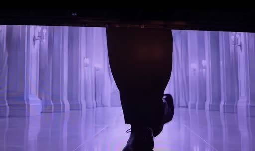 | 보랏빛 대리석 복도, 걷는 구두 발끝 로우앵글 (트래킹) | (상단 고정) 와….. 역대급 하객 반응! 진짜 배우같은 신랑입장 / 파티움 그랜드컨벤션홀 | 음악 | 훅 — 얼굴 없이 발걸음만 |
| c02 | 0:03–0:09 | 6.0 | 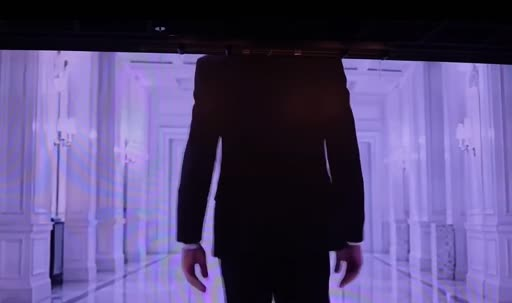 | 같은 복도, 가슴~허리만 보이게 걸어오는 정장 (얼굴은 프레임 밖), 카메라 뒤로 빠지며 따라감 | 〃 | 〃 | 빌드업 — 주인공 존재감 |
| c03 | 0:09–0:14 | 5.0 | 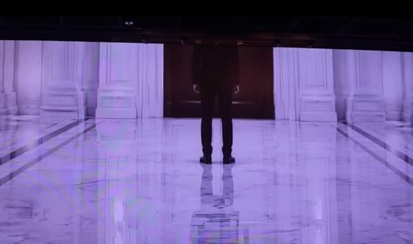 | 좌우 대칭 와이드: 긴 복도 끝 문 앞에 선 신랑 (멀리, 작게) | 〃 | 〃 | 빌드업 — 공간·무게감 |
| c04 | 0:14–0:15.5 | 1.5 | 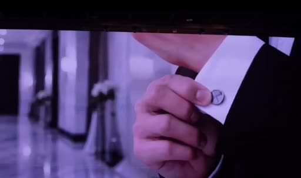 | 커프스 단추 만지는 손 익스트림 클로즈업 | 〃 | 〃 | 디테일 — "준비 완료" |
| c05 | 0:15.5–0:16 | 0.5 | 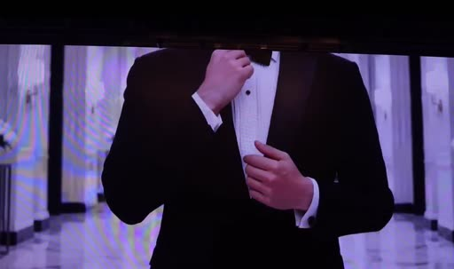 | 재킷 단추 잠그는 상반신 (얼굴 X) | 〃 | 〃 | 디테일 |
| c06 | 0:16–0:19.5 | 3.5 | 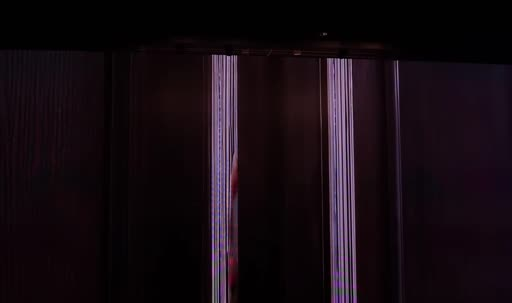 | 어두운 나무 문, 세로 손잡이 두 개 정면 (정지) | 〃 | 〃 | 긴장 — "곧 이 문이 열린다" |
| c07 | 0:19.5–0:21.5 | 2.0 | 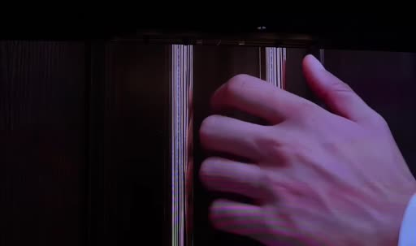 | 손이 화면 밖에서 들어와 손잡이를 잡음 | 〃 | 〃 | 긴장 — 실제 문과 연결되는 복선 |
| c08 | 0:21.5–0:23 | 1.5 | 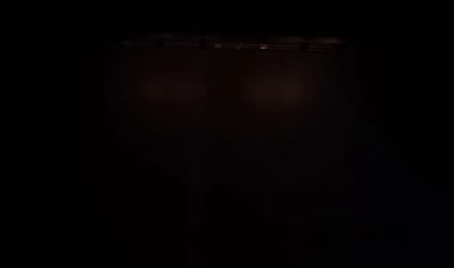 | 암전 (검은 화면) | 〃 | 〃 | 숨 고르기 |
| c09 | 0:23–0:25.7 | 2.7 | 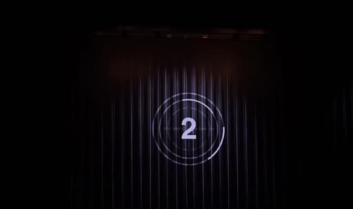 | 어두운 커튼 배경 + 원형 링 카운트다운 **3 · 2 · 1** | 3, 2, 1 | 〃 | 카운트다운 |
| c10 | 0:25.7–0:26 | 0.3 | 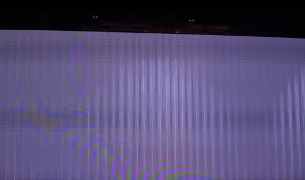 | 화면 전체가 하얗게 번쩍 (플래시) | 없음 | 〃 | 신호 |
| c11 | 0:26–0:28 | 2.0 | 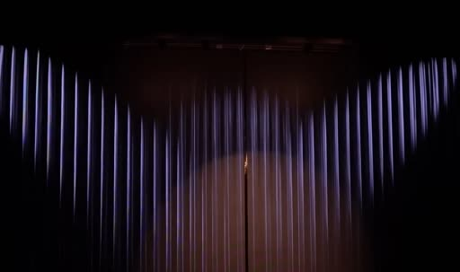 | 커튼 그림 위로 무대 조명이 V자로 쓸고 지나감 → 가운데로 모임 | 없음 | 〃 | 무대 오픈 연출 |
| c12 | 0:28–0:28.5 | 0.5 | 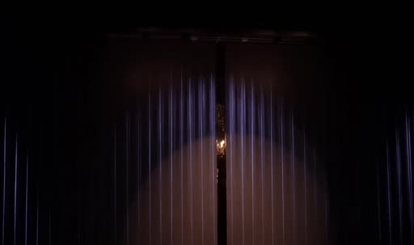 | **닫힌 커튼 + 가운데 스포트라이트** 정지 화면. 커튼이 갈라지는 자리 = 실제 문 이음새 | 없음 | 〃 | 대기 화면 |
| c13 | 0:28.5–0:30.5 | 2.0 | 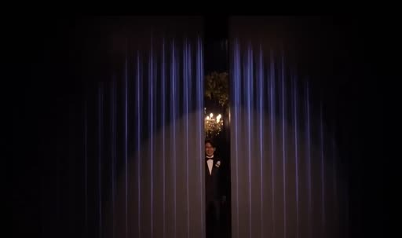 | (현장) 화면 속 커튼이 갈라지듯 **실제 문이 열림**, 안쪽 샹들리에·꽃장식과 신랑이 보임. 약 2초 만에 열림 | 없음 | 〃 | 문 열림 |
| c14 | 0:30.5–0:36.5 | 6.0 | 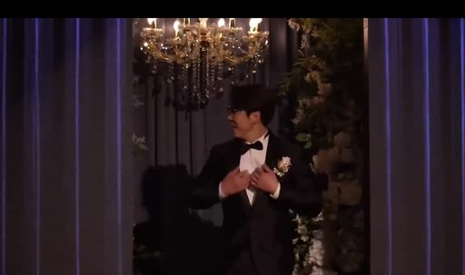 | (현장) 신랑이 걸어 나와 손 제스처·미소, 하객 쪽을 봄 | 없음 | 〃 | 등장 |
| c15 | 0:36.5–0:38.5 | 2.0 | 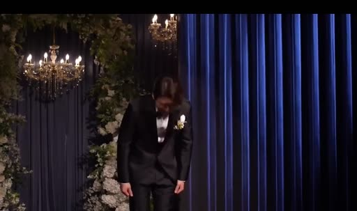 | (현장) 허리 숙여 인사 | 없음 | 〃 | 인사 |
| c16 | 0:38.5–0:41.7 | 3.2 | 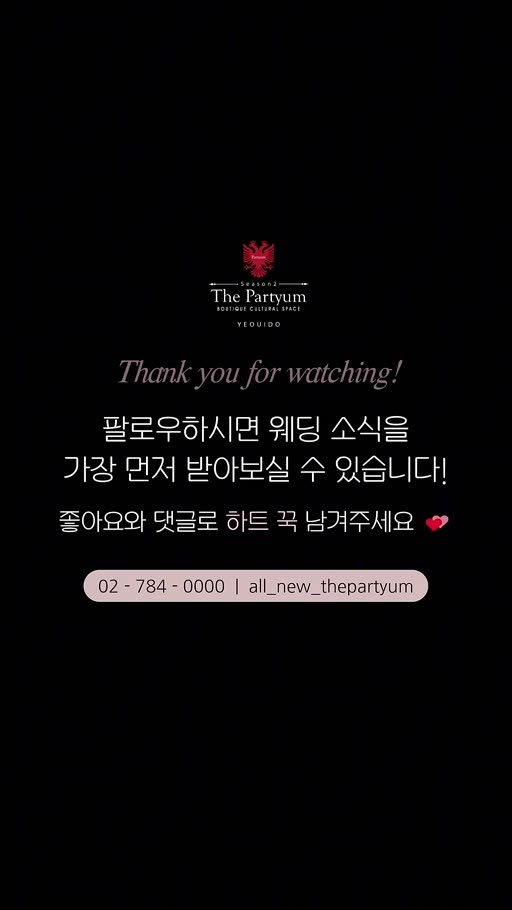 | 엔딩 카드: 로고 + "Thank you for watching!" + 팔로우·좋아요 안내 + 연락처 | 팔로우하시면 웨딩 소식을 가장 먼저… | 음악 끝 | CTA (예식장 홍보) — 우리 영상에는 해당 없음 |

## 이 영상의 핵심 장치
1. **얼굴을 끝까지 숨기고 실물로 공개:** 화면 속 신랑은 발·몸통·손만 나오고 얼굴은 한 번도 안 나와요. 얼굴은 문이 열릴 때 실물로 처음 보이고, 그래서 "배우 같은 등장"이 됩니다.
2. **화면 속 문 → 실제 문:** 영상 속에서 문 손잡이를 잡는 손(c07)을 보여 준 뒤 카운트다운 3·2·1 → 플래시로 넘어가요. 시청자 머릿속에서 "그 문"이 실제 문으로 이어집니다.
3. **마지막 화면을 실제 문과 한 몸처럼 디자인:** 대기 화면이 "닫힌 커튼 + 가운데 스포트라이트"예요. 커튼이 갈라지는 자리가 딱 문 이음새라서, 문이 열릴 때 커튼이 걷히는 것처럼 보입니다.
