# 02. 5 Super Hero (구조 참고용)

- **제목:** 5 Super Hero (파일명 기준. 유튜브 원제는 확인 불가)
- **링크:** https://youtu.be/JdG2ujaGAUU
- **길이:** 1분 56초 (116.5초)
- **플랫폼 추정:** 16:9 스크린 상영용 신랑 입장 영상 원본(편집 완료본)
- **용도 메모:** 신랑 측이 좋아한 영상은 아니고 **구조만 참고**하라고 보낸 영상. 연출이나 톤은 따라가지 않는다.
- **총 컷 수:** 12컷 (부드러운 전환이 많아 장면 단위로 나눔)
- **평균 컷 길이:** 문 열리기 전 구간 약 2.7초 (29.6초 ÷ 11컷) + 대기 화면 79초
- **오디오:** 자막 없음. 화면의 영어 가사 글자로 보아 노래 가사에 맞춘 편집

## 컷 분석

| 컷 | 시간 | 길이(초) | 캡처 | 화면 구성 (구도·피사체·카메라 움직임) | 자막/화면 텍스트 | 대사·음악 | 역할 |
|---|---|---|---|---|---|---|---|
| c01 | 0:00–0:03 | 3.0 | 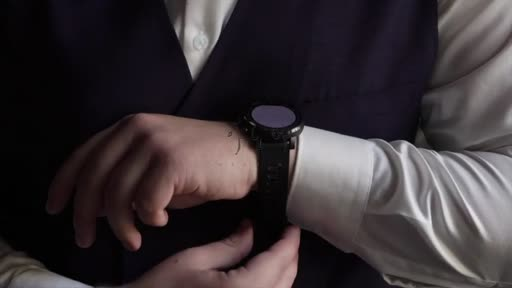 | 검은 화면 속 작은 창 → 손목시계·손 클로즈업 (얼굴 X) | (손글씨 이름 로고 잠깐) | 노래 | 훅 — 디테일 |
| c02 | 0:03–0:06 | 3.0 |  | 검은 배경 + 네온 그린 모션 그래픽 | Knocked Down, | 〃 | 가사 타이포 |
| c03 | 0:06–0:08 | 2.0 | 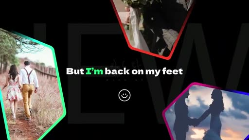 | 네온 테두리 다각형 액자 속 커플 사진 콜라주, 뒤에 큰 글자 NEW | But I'm back on my feet | 〃 | 두 사람 이야기 |
| c04 | 0:08–0:10.6 | 2.6 | 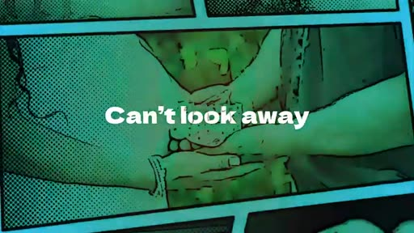 | 코믹북 하프톤 패널, 손 잡은 커플 | Can't look away | 〃 | 두 사람 이야기 (만화풍) |
| c05 | 0:10.6–0:13.7 | 3.1 | 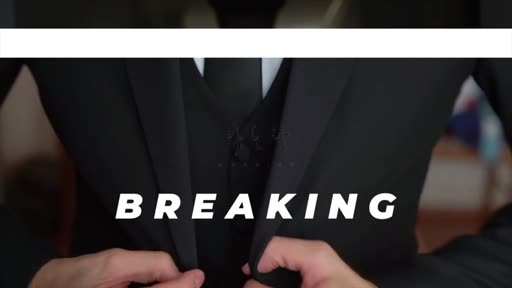 | 재킷 단추 잠그는 손 클로즈업 | JUST BREAKING | 〃 | 디테일 — 준비 |
| c06 | 0:13.7–0:16 | 2.3 | 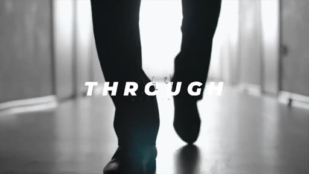 | 밝은 복도를 걷는 발 (얼굴 X) | THROUGH | 〃 | 걷기 — 입장 예고 |
| c07 | 0:16–0:26 | 10.0 | 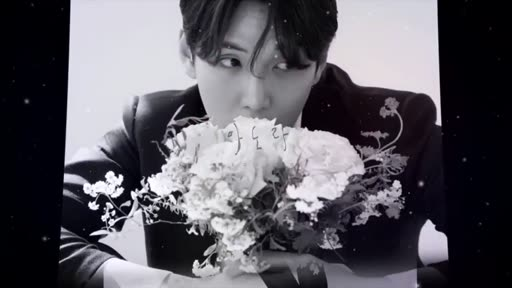 | 흰 벽 스튜디오 화보(앉은 포즈·꽃다발) 5~6장이 우주 배경 위로 차례로 넘어감 | 없음 | 〃 | 신랑 얼굴 공개 (화보) |
| c08 | 0:26–0:28.4 | 2.4 | 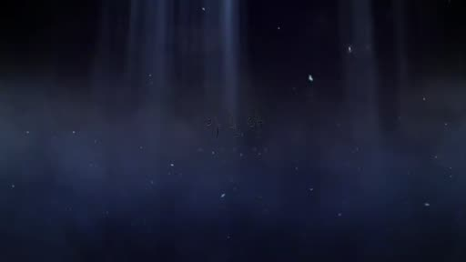 | 어두운 우주 공간, 번개 | 없음 | 〃 | 긴장 — 숨 고르기 |
| c09 | 0:28.4–0:29.6 | 1.2 | 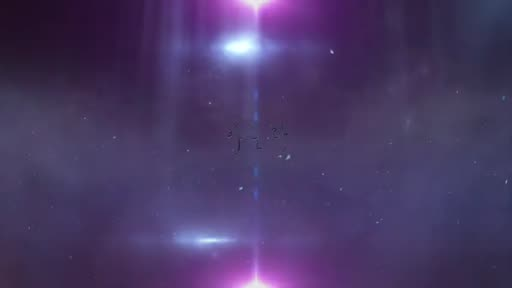 | 어둠 속 보랏빛 섬광 한 점 | 없음 | 〃 | 터지기 직전 |
| c10 | 0:29.6–0:31 | 1.4 | 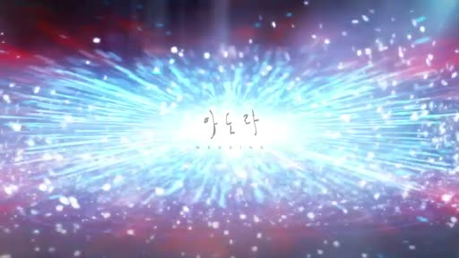 | 화면 가득 우주 폭발(워프) + 가운데 손글씨 이름 로고 | (이름 로고) | 〃 | 클라이맥스 = 문 열림 신호 |
| c11 | 0:31–0:37 | 6.0 | 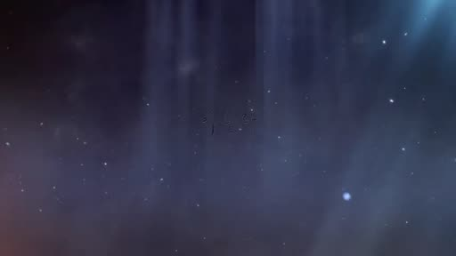 | 어두운 푸른 입자 공간으로 가라앉음 | 없음 | 〃 | 감속 → 대기 화면으로 연결 |
| c12 | 0:37–1:56 | 79.0 | 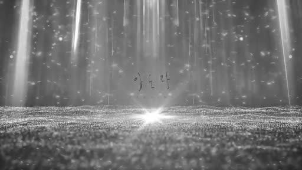 | 회색 빛줄기가 내려오고 바닥에서 빛이 반짝이는 **반복 배경** (가운데 빛 한 점) | 없음 | 〃 | 대기 화면 (루프) |

## 이 영상의 핵심 장치 (구조만)
1. **약 30초에 클라이맥스:** 어둠 → 섬광 → 폭발 + 이름 로고 순서로 "지금 문 열림"을 알린다. 01·03과 같은 30초 전후 구조.
2. **클라이맥스 다음에 "감속 구간"(6초)을 두고 대기 화면으로 넘어간다.** 폭발에서 바로 정지 화면으로 가지 않고, 천천히 가라앉아 루프로 이어진다.
3. **대기 화면은 단순한 반복 배경**(빛줄기 + 반짝임). 가운데가 비어 있고 좌우가 대칭이라 문이 갈라져도 그림이 깨지지 않는다.
