# 03. LED 문 신랑 입장 — 하객 촬영 현장본

- **제목:** (카카오톡으로 받은 영상, 원제 없음) KakaoTalk_20261018_141538518.mp4
- **링크:** 없음 (사용자 업로드)
- **길이:** 1분 20초 (79.7초)
- **플랫폼 추정:** 하객이 휴대폰 세로로 찍은 현장 기록 영상. 편집 없음 (원테이크)
- **찍힌 것:** 예식장 정면의 가로로 긴 LED 스크린에 틀어진 **신랑 입장 영상(0~33초)** + 스크린 가운데가 **문처럼 반으로 열리며 신랑이 등장하는 장면(33~80초)**
- **총 컷 수:** 22컷 (스크린 영상 15컷 + 현장 7구간)
- **평균 컷 길이:** 스크린 영상 구간 약 2.2초 (33초 ÷ 15컷) / 현장 구간은 원테이크
- **참고:** 촬영 시작 시점에 스크린 영상이 이미 재생 중이었을 수 있음 (0초가 영상의 진짜 시작인지 불확실)
- **오디오:** 자막 없음, 휴대폰 녹음이 처음부터 끝까지 큰 음악으로 꽉 차 있어(소리 크기 거의 일정) 대사·사회자 멘트는 확인 불가

## 컷 분석

### A. 스크린에 나온 신랑 입장 영상 (0~33초)

| 컷 | 시간 | 길이(초) | 캡처 | 화면 구성 (구도·피사체·카메라 움직임) | 자막/화면 텍스트 | 대사·음악 | 역할 |
|---|---|---|---|---|---|---|---|
| c01 | 0:00–0:03 | 3.0 | 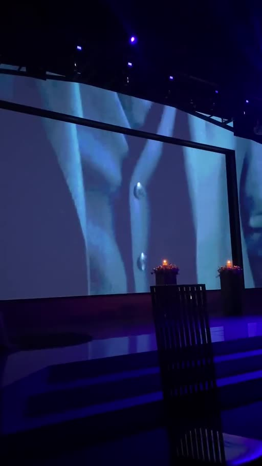 | 수트 디테일 익스트림 클로즈업 (단추·소매·손), 어둡고 푸른 톤, 느린 움직임 | 없음 | 음악 (확인 불가) | 훅 — 얼굴 없이 "준비하는 남자" 암시 |
| c02 | 0:03–0:05 | 2.0 | 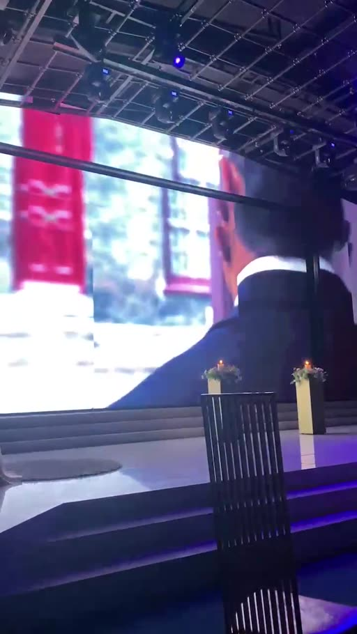 | 신랑 어깨 너머 뒷모습, 붉은 문이 있는 거리를 걸어감 (팔로우 숏) | 없음 | 〃 | 빌드업 — 주인공 등장(얼굴 숨김) |
| c03 | 0:05–0:08 | 3.0 | 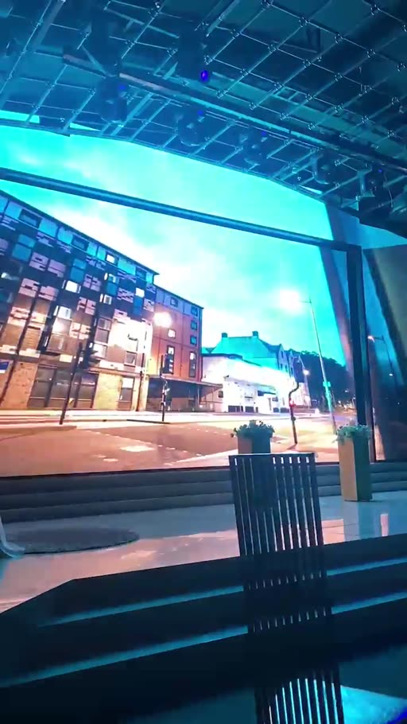 | 유럽풍 거리·건물 로우앵글, 밝은 하늘, 시안 톤 | 없음 | 〃 | 빌드업 — 세계관(도시) |
| c04 | 0:08–0:11 | 3.0 | 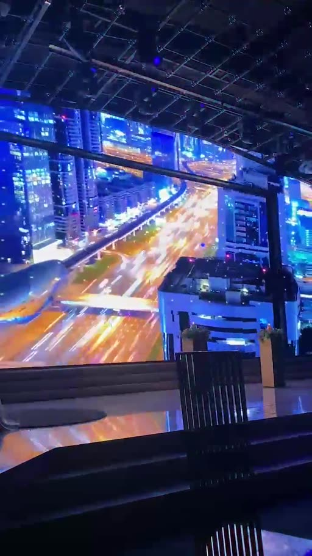 | 도시 야경 하이퍼랩스, 도로 빛줄기, 고층 빌딩 | 없음 | 〃 | 빌드업 — 속도감 상승 |
| c05 | 0:11–0:13 | 2.0 | 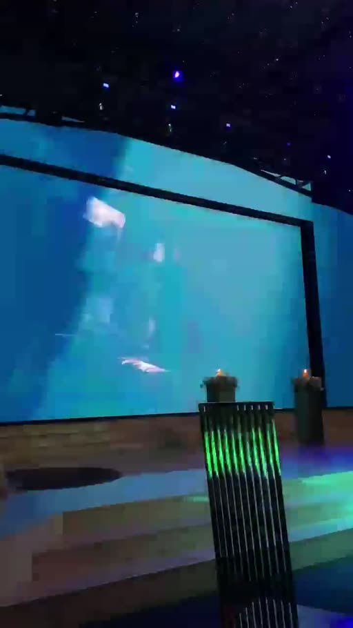 | 어두운 청록 화면 + 흐릿한 모션 블러 인물 (전환 컷) | 없음 | 〃 | 전환 — 숨 고르기 |
| c06 | 0:13–0:16 | 3.0 | 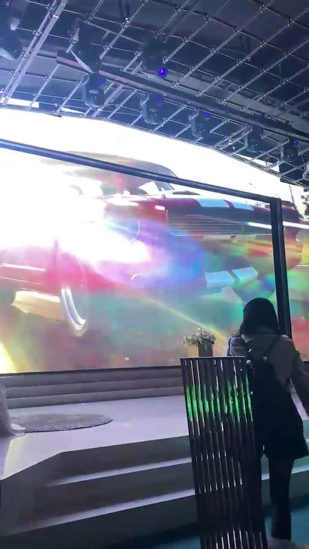 | 스포츠카 측면 + 강한 렌즈 플레어·빛 번짐 (자동차 광고풍) | 없음 | 〃 | 빌드업 — "영화 예고편" 무드 |
| c07 | 0:16–0:17 | 1.0 | 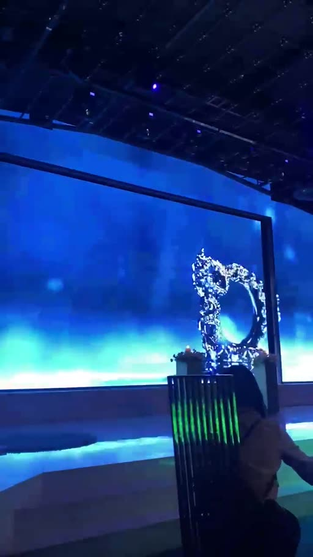 | 파란 반짝임 위 장식 엠블럼(왕관/모노그램 느낌) | 없음 | 〃 | 전환 — 챕터 구분 |
| c08 | 0:17–0:20 | 3.0 | 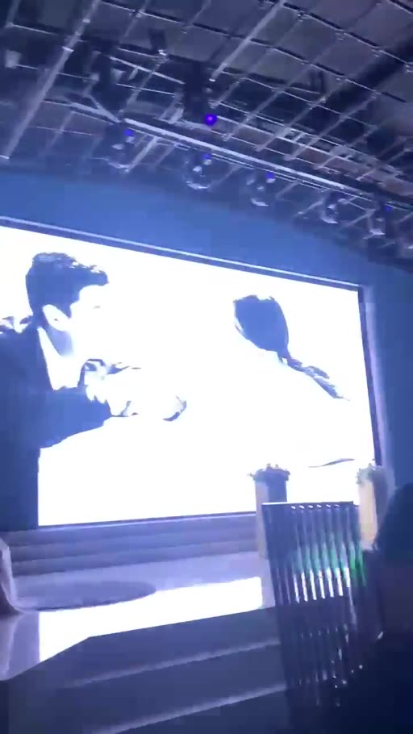 | 흰 배경 커플 웨딩 화보, 사진이 빠르게 바뀜 (스톱모션) | 없음 | 〃 | 감정 — 신랑·신부 관계 보여주기 |
| c09 | 0:20–0:21 | 1.0 | 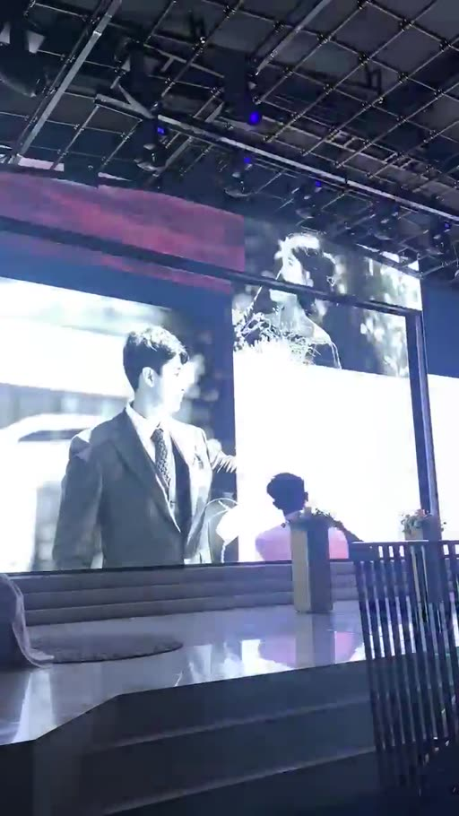 | 화면 분할: 왼쪽 흑백 정장 사진 / 오른쪽 재킷을 어깨에 건 뒷모습 | 없음 | 〃 | 빌드업 — 캐릭터 포즈 |
| c10 | 0:21–0:22 | 1.0 | 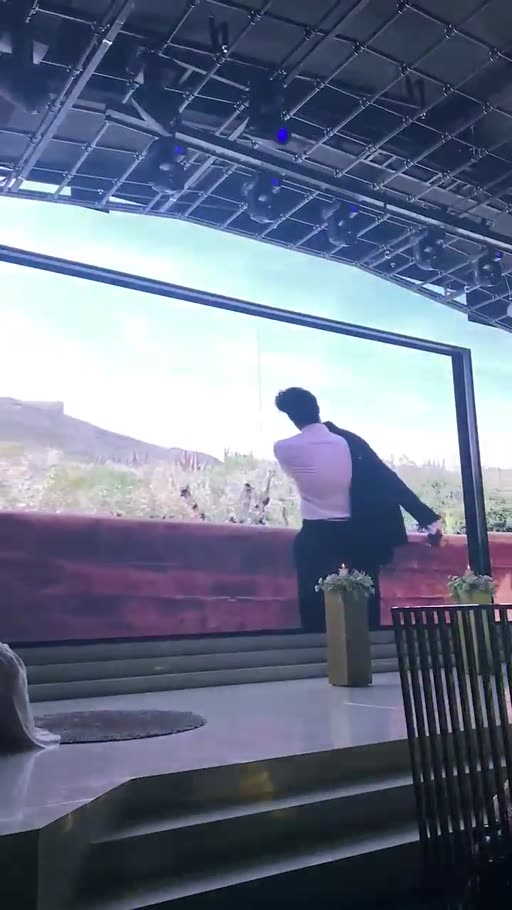 | 들판에서 재킷을 어깨에 걸치며 걸어가는 신랑 (와이드) | 없음 | 〃 | 빌드업 — "배우" 포즈 |
| c11 | 0:22–0:23 | 1.0 | 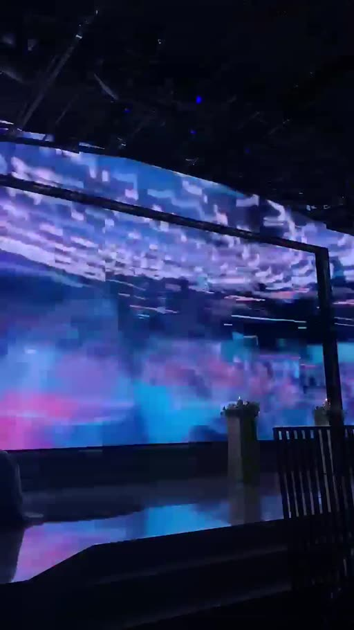 | 보라·파랑 빛 번짐 블러 전환 | 없음 | 〃 | 전환 — 무대 모드로 진입 |
| c12 | 0:23–0:29 | 6.0 | 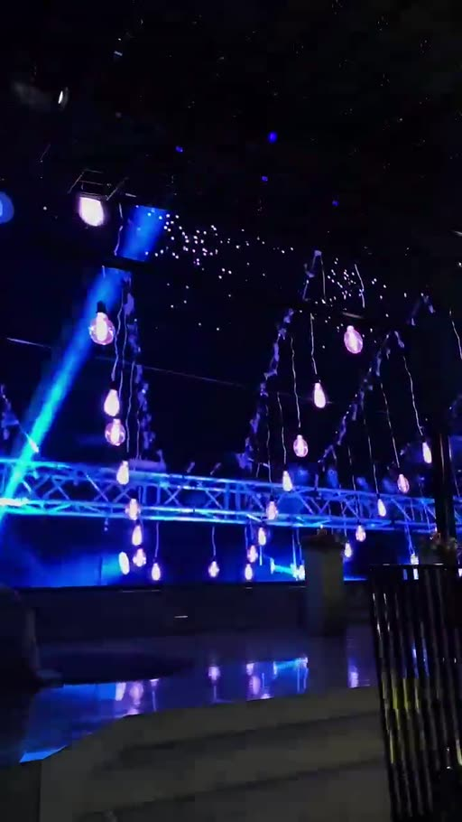 | 콘서트 무대 트러스·조명 CG, 어두웠다 밝았다 깜빡임 (화면 일부 암전) | 없음 | 〃 | 긴장 — "곧 무대에 선다" 카운트다운 |
| c13 | 0:29–0:30.5 | 1.5 | 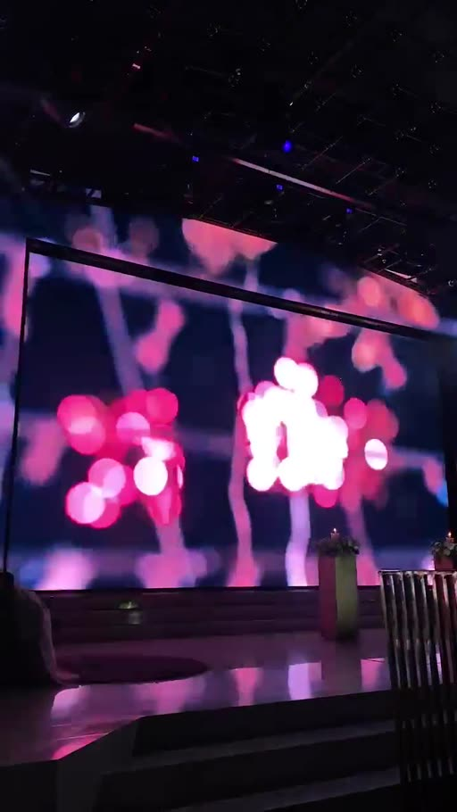 | 분홍 보케(빛 망울) 위에 **GROOM** 글자 | GROOM | 〃 | 타이틀 예고 |
| c14 | 0:30.5–0:32.5 | 2.0 |  | 검은 화면 + 스포트라이트를 받는 **G R O O M** 글자, 글자 간격이 벌어짐 | GROOM | 〃 | 클라이맥스 — 타이틀 |
| c15 | 0:32.5–0:33 | 0.5 | 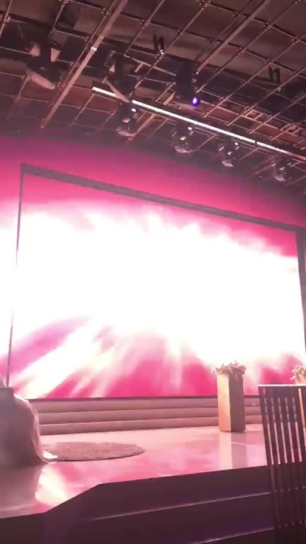 | 화면 전체 화이트 플래시 → 붉은 빛 폭발 | 없음 | 〃 | 신호 — "지금 문 열림" |

### B. 문이 열리고 신랑이 입장 (33~80초, 스크린은 마지막 화면을 계속 유지)

| 컷 | 시간 | 길이(초) | 캡처 | 화면 구성 (구도·피사체·카메라 움직임) | 자막/화면 텍스트 | 대사·음악 | 역할 |
|---|---|---|---|---|---|---|---|
| c16 | 0:33–0:34 | 1.0 | 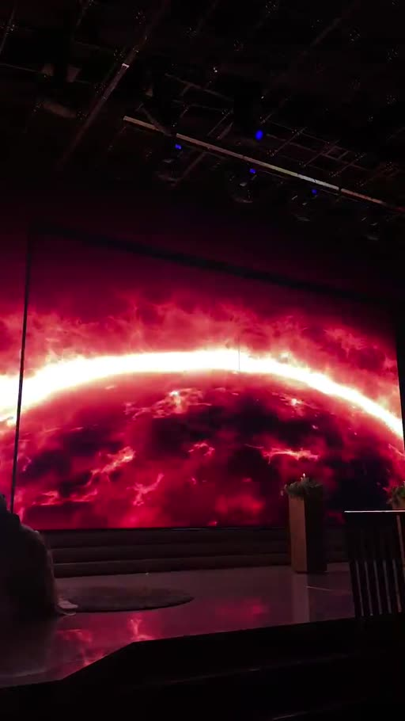 | 스크린: 붉은 행성 지평선(일출) 정지 화면, 문 닫힘 | 없음 | 음악 | 대기 화면 (문 열리기 직전) |
| c17 | 0:34–0:42 | 8.0 | 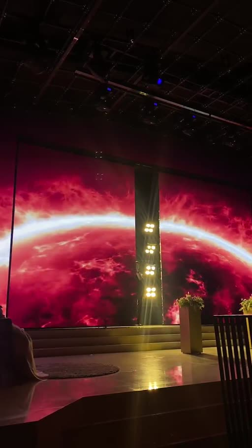 | 스크린 가운데 이음새가 갈라지며 **문이 천천히 양쪽으로 열림**, 뒤에 조명 8개가 박힌 패널이 드러남. 행성 화면은 열린 양쪽 문 위에서 그대로 재생 | 없음 | 〃 | 문 열림 (약 8초 걸림) |
| c18 | 0:42–0:45 | 3.0 | 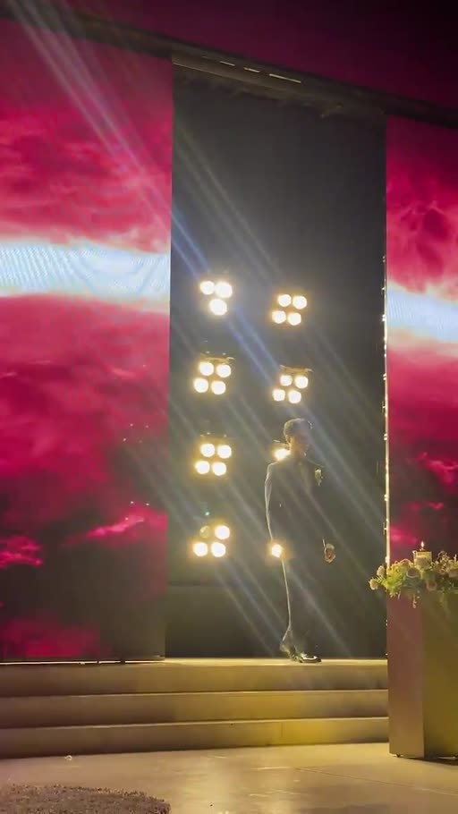 | 역광 속 신랑 실루엣 → 앞으로 걸어 나와 정면에 섬 | 없음 | 〃 | 등장 |
| c19 | 0:45–0:46 | 1.0 | 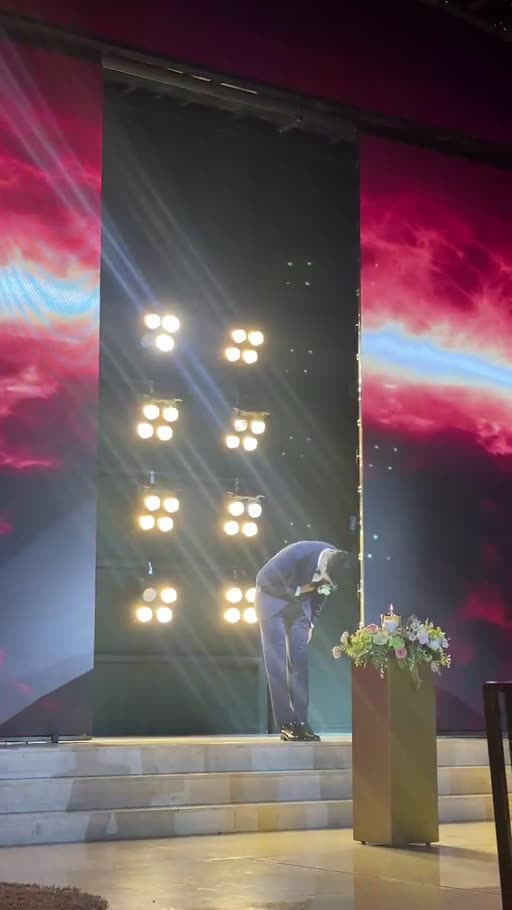 | 신랑이 하객에게 허리 숙여 인사 | 없음 | 〃 (박수 추정) | 인사 |
| c20 | 0:46–0:53 | 7.0 | 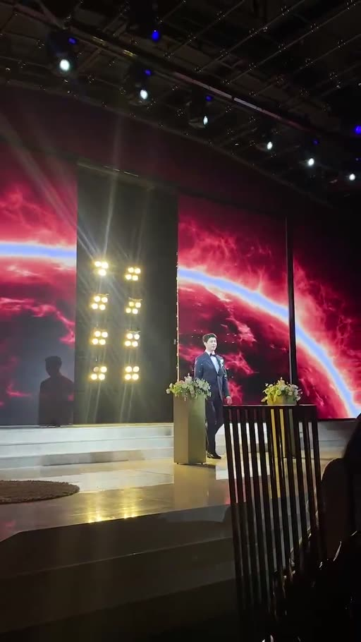 | 신랑이 정면에 선 채 → 계단을 내려옴. 하객 손 흔듦 | 없음 | 〃 | 무대 → 버진로드 |
| c21 | 0:53–1:15 | 22.0 | 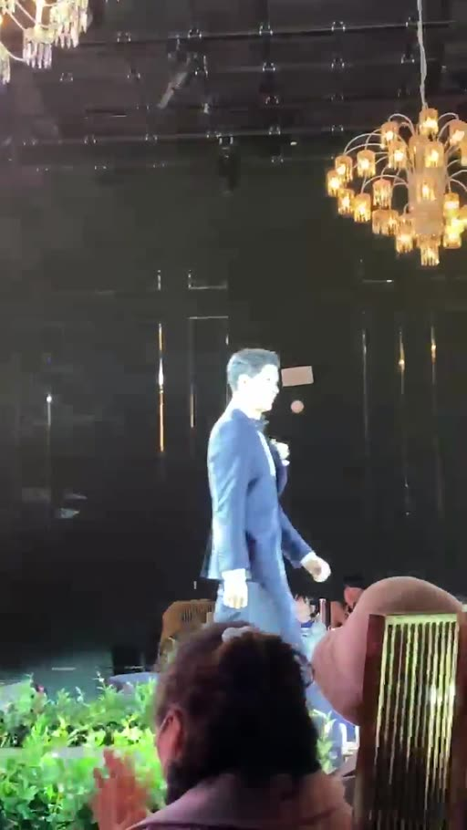 | 버진로드를 걸어감, 하객석 사이 스포트라이트·샹들리에. 촬영자가 따라 돌며 패닝 | 없음 | 〃 | 입장 걷기 |
| c22 | 1:15–1:20 | 5.0 | 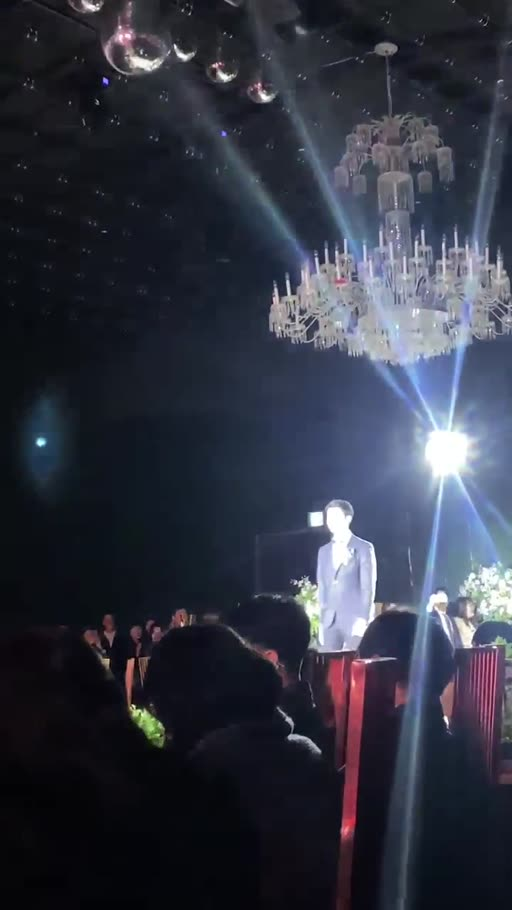 | 앞쪽 단상 도착, 조명 암전 | 없음 | 음악 페이드 | 마무리 |

## 이 영상의 핵심 장치
1. **"영화 예고편 → 콘서트 무대 → 타이틀" 3단 상승:** 얼굴을 숨긴 수트 디테일로 시작해 도시·자동차(광고 무드) → 화보 → 콘서트 무대로 점점 커지고, 마지막에 **GROOM 타이틀 + 화이트 플래시**로 "지금이다" 신호를 준 뒤 문이 열린다.
2. **문은 생각보다 느리게 열린다 (약 8초):** 영상의 마지막 화면(붉은 행성)이 문이 열리는 동안·신랑이 걷는 동안 **계속 배경으로 남는다.** 즉 마지막 장면은 "멈춰도 멋있고, 반으로 갈라져도 멋있는" 화면이어야 한다.
3. **문 이음새(화면 정중앙)를 비워 둔다:** 클라이맥스 GROOM 글자를 가운데 두었지만, 문이 열리기 전에 사라지고 행성의 지평선처럼 **가로로 이어지는 그림**으로 바뀐다 — 가운데가 갈라져도 그림이 망가지지 않는다.
