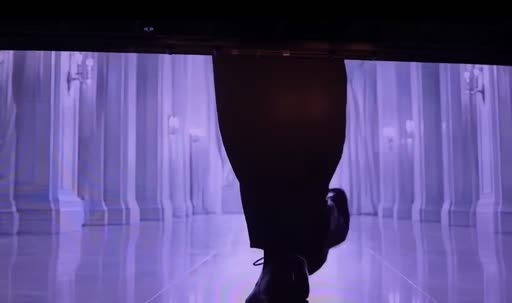
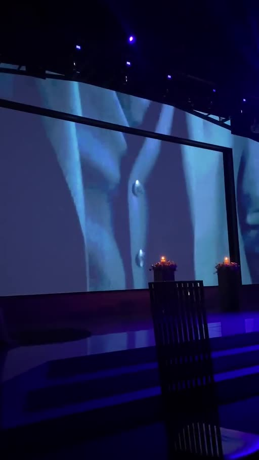
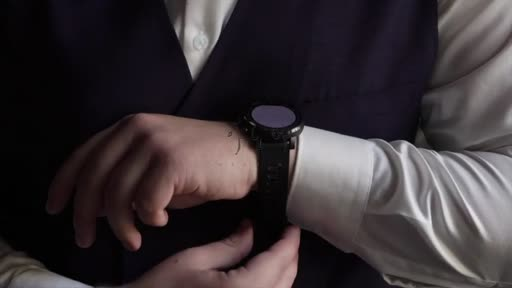
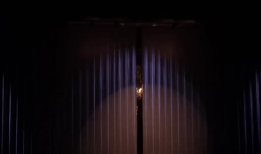
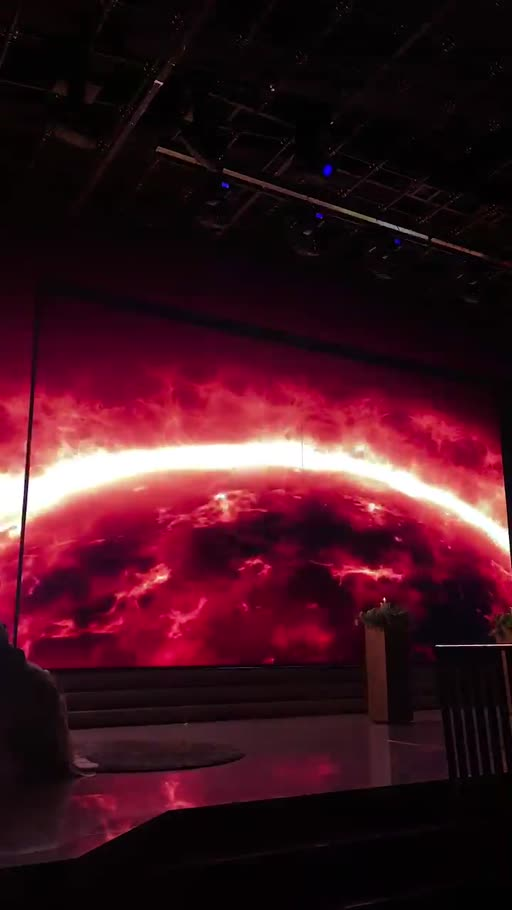
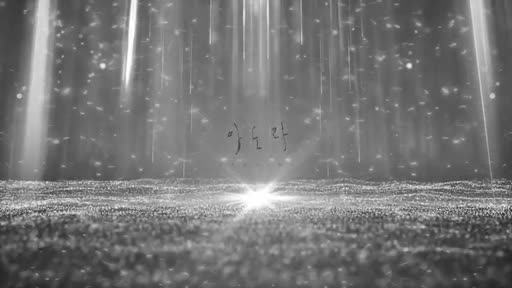

# 패턴 비교표

> **비중:** 01(파티움)과 03(카톡 현장)이 가장 가까운 레퍼런스. 02는 신랑 측이 좋아한 영상이 아니라서 **구조만** 참고한다.
> 01은 예식장 홍보 쇼츠, 03은 하객 촬영본이라 **스크린에 틀어진 영상 부분만** 비교했다.

## 나란히 비교

| 항목 | 01 배우처럼 등장한 신랑 ★ | 03 카톡 현장 (LED 문) ★ | 02 5 Super Hero (구조만) |
|---|---|---|---|
| 클라이맥스(문 열림 신호) 위치 | 약 25.7초 | 약 32.5초 | 약 29.6초 |
| 컷 수 / 평균 컷 길이 (클라이맥스까지) | 12컷 / 약 2.4초 | 15컷 / 약 2.2초 | 11컷 / 약 2.7초 |
| 훅 (첫 3초) | 걷는 구두 발끝  | 수트 디테일  | 손목시계·손  |
| 신랑 얼굴 | **끝까지 숨김** → 실물로 공개 | 뒷모습 위주, 화보에서 잠깐 | 중반(16~26초) 화보로 공개 |
| 전개 순서 | 걷기 → 공간 → 디테일 → **문 손잡이** → 암전 → 카운트다운 → 플래시 → 대기 화면 | 디테일 → 도시·자동차 → 화보 → 콘서트 무대 → GROOM → 플래시 → 대기 화면 | 디테일 → 커플 이야기 → 디테일·걷기 → 화보 → 어둠·섬광 → 폭발+이름 → 감속 → 대기 화면 |
| 톤·색감 | 보라·흰색 → 검정·남색 커튼, 절제된 고급 | 네온 블루·핑크 → 붉은 행성, 화려함 | 네온 그래픽·만화풍 → 흑백 화보 → 우주 |
| 화면 텍스트 | 숫자 3·2·1만 | GROOM 한 단어 | 노래 가사 (영어) + 손글씨 이름 |
| 클라이맥스 직전 "멈춤" | 암전 1.5초 + 카운트다운 | GROOM 타이틀 2초 | 어둠·섬광 3.6초 |
| 클라이맥스 신호 | 화이트 플래시 0.3초 | 화이트 플래시 0.5초 | 우주 폭발 + 이름 로고 1.4초 |
| 클라이맥스 → 대기 화면 | 조명 쓸고 지나감 2초 | 바로 | 감속 6초 |
| 대기 화면 | 닫힌 커튼 + 가운데 스포트라이트  | 붉은 행성 지평선  | 회색 빛줄기 루프  |
| 대기 화면과 문 이음새 | 커튼 갈라지는 자리 = 이음새 | 가로 지평선이라 갈라져도 OK | 좌우 대칭, 가운데 빛 한 점 |

## 우리 영상 조건
- 16:9, mp4 / **30~33초에 문 열림** / 문이 열린 뒤 **대기 화면 약 20초 + 루프** (문 열리는 데 걸리는 시간은 신경 쓰지 않아도 됨)
- 음원(이원석 「큐사인」)은 **참고용**. 실제 편집은 작업자가 알아서 맞춘다. 참고로 이 음원은 0:29.5 끊김 → 0:30 터짐 구조라 30초 클라이맥스와 잘 맞는다.

## 공통 패턴 (가져갈 것)
1. **클라이맥스는 약 30초.** 세 영상 모두 26~33초 사이에서 "문 열림 신호"를 준다.
2. **직전에 "멈춤" 한 박자** (암전, 카운트다운, 타이틀, 어둠 속 섬광 등). 1.5~3.5초.
3. **짧고 강한 신호:** 화이트 플래시나 폭발. 이 순간에 문이 열린다.
4. **첫 3초 훅은 얼굴 없는 디테일** (구두·수트·시계·손). 세 영상 모두 같다.
5. **디테일 → 걷기 → (화보) → 멈춤 → 신호 → 대기 화면** 순서. 컷은 2~3초.
6. **대기 화면은 가운데가 갈라져도 예쁜 그림** (좌우 대칭, 가로로 이어지는 형태). 글자나 얼굴을 정중앙에 두지 않는다.
7. **화면 텍스트는 최소화** (한 단어, 숫자, 이름 정도).

## 차별 포인트 (피할 것 또는 비틀 것)
- 01의 엔딩 카드(팔로우·연락처)는 홍보용이라 제외.
- 03처럼 장면을 너무 많이 바꾸면(도시·자동차·콘서트) 신랑과의 연결이 약해진다 → 01처럼 한 세계관으로 묶는 편이 선명하다.
- 02의 네온·만화풍 그래픽과 영어 가사 타이포는 톤이 달라 피한다. **구조만 빌린다**: 클라이맥스 뒤에 감속 구간을 두고 대기 화면으로 자연스럽게 넘어가는 것.
- **비틀 후보:** 01의 "화면 속 문 손잡이 → 실제 문"을 우리 예식장 문에 맞춰 쓰기 / 카운트다운 숫자 대신 두 사람에게 의미 있는 숫자(만난 날, 예식일)

## brief를 정할 때 같이 고를 것
1. **톤:** 01처럼 절제된 고급 / 03처럼 화려한 영화 예고편 / 그 중간
2. **신랑 얼굴:** 끝까지 숨김(01) / 화보로 일부 공개(02·03)
3. **멈춤 장치:** 카운트다운 / GROOM 같은 타이틀 / 이름 로고 / 그 밖의 아이디어
4. **대기 화면(20초 루프):** 커튼 / 지평선 / 빛줄기 / 우리 예식장 문과 이어지는 그림
5. **소스:** 새로 찍을 수 있는 컷(복도 걷기, 디테일)이 있는지, 웨딩 화보만 쓸지
