# 스토리보드 — 신랑 입장 영상

- 본편 **0:00~0:33 (33초)**, 문 열림 신호 = S13~S14 (0:28~0:32). 이어서 대기 화면 W1(1회) + **W2 20초 루프**
- 16:9 mp4 / 소스 전부 생성형 AI / 신랑 얼굴 끝까지 숨김
- AI 프롬프트의 `[GROOM]`·`[OUTFIT]`·`[UNIFORM]`·`[STADIUM]`·`[CORRIDOR]`·`[DOOR]`·`[STYLE]`은 `brief.md`의 공통 문구로 바꿔 넣는다 (장소·의상을 바꿀 때는 brief의 해당 문구만 수정)
- **AI 이미지** 열은 확정된 생성 이미지(`ai/씬번호.jpg`). 참고 컷의 `user/`는 사용자가 보낸 참고 이미지, `01·02·03/`은 레퍼런스 캡처

| 씬 | 시간 | AI 이미지 | 화면 설명 | 자막·카피 | 오디오 | 참고 패턴 (영상 번호·컷) | 참고 컷 | 메모 | AI 프롬프트 |
|---|---|---|---|---|---|---|---|---|---|
| **S01** | 0:00–0:04 (4초) | 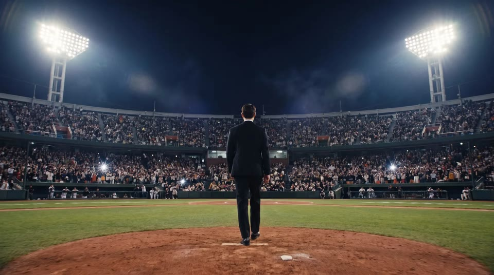 | 마운드에서 출발하는 신랑의 뒷모습 와이드. 낮은 앵글·좌우 대칭(조명탑이 양옆), 관중석 플래시. 카메라는 거의 고정, 아주 느리게 다가감 | 없음 | 음악 도입(잔잔) + 관중 함성 앰비언스 | 03 c02 뒷모습 / 01 c03 대칭 와이드로 공간·무게감 | 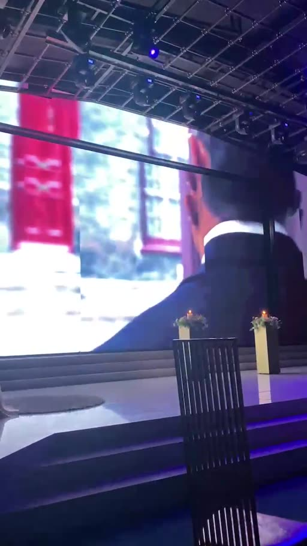 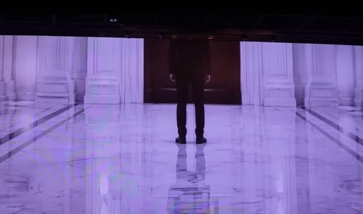 | ✅ AI 이미지 확정. 이후 모든 씬의 색감·조명 기준 컷(참고 이미지로 함께 넣기) | `Low-angle symmetrical wide rear view, camera behind him: [GROOM], wearing [OUTFIT], walking away from the camera off the pitcher's mound of [STADIUM]. Two floodlight towers frame the left and right of the frame, crowd camera flashes sparkle in the stands, players lined up at both dugout rails. Camera nearly static with a very slow push-in, 24mm wide lens, floodlight lens flare. [STYLE]` |
| **S02** | 0:04–0:08 (4초) | 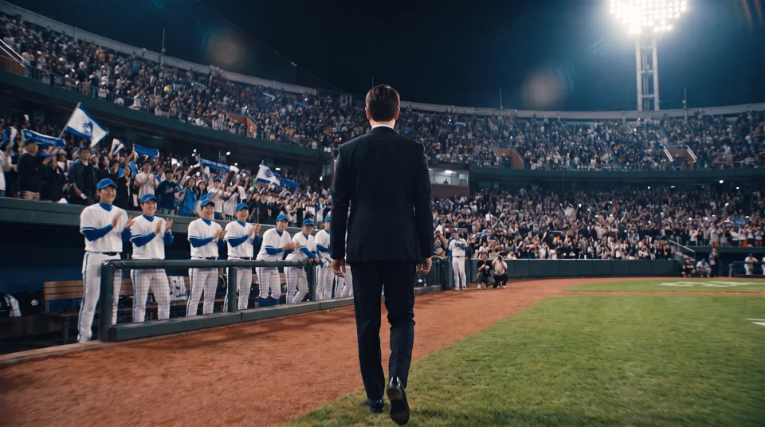 | 컷이 바뀌면 이미 3루 쪽 더그아웃 근처. 파울라인을 따라 비스듬히 걸어가는 뒷모습을 등 뒤 어깨 높이에서 핸드헬드로 따라감. 앞쪽 더그아웃 난간의 선수들이 그를 향해 돌아섬 | 없음 | 관중 함성 + 발소리 | 01 c02 걷기로 존재감 쌓기 / 03 c02 뒷모습 팔로우 | 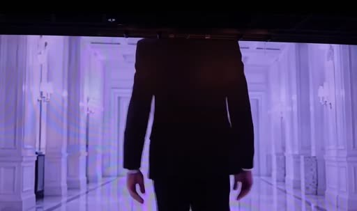  | ✅ AI 이미지 확정. S01→S02는 **점프컷**(같은 뒷모습·같은 화면 중앙 위치로 이동 거리를 건너뜀). 발걸음이나 음악 박자에 맞춰 자르기 | `Rear view, camera directly behind him at shoulder height: [GROOM], wearing [OUTFIT], walking away from the camera along the third-base foul line toward the dugout a few steps ahead. We see only the back of his head, his shoulders and his back. [STADIUM]. [UNIFORM], lined up at the dugout rail ahead, smiling and starting to clap. Handheld 35mm, slight natural shake, slight motion blur on the legs. [STYLE]` |
| **S03** | 0:08–0:11 (3초) | 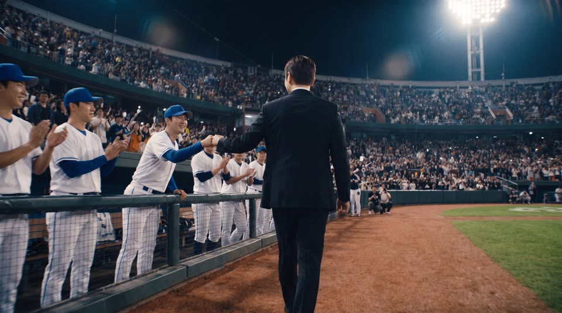 | 더그아웃 난간을 따라 걸으며, 고개는 정면을 둔 채 옆 선수와 가볍게 주먹 인사하는 뒷모습. 등 뒤 핸드헬드 팔로잉, 나머지 선수들은 박수 | 없음 | 0:08 음악 빌드업 시작 + 선수들 환호·박수 | 03 c10 '배우' 같은 여유 / 03 c02 뒷모습 팔로우 | 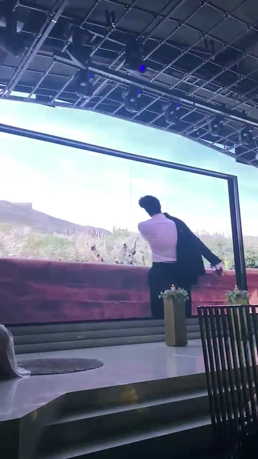  | S02→S03 점프컷(뒷모습 유지). 고개를 돌리면 옆얼굴이 나오니 '정면을 본 채 팔만 옆으로'. ✅ AI 이미지 확정. 음악이 커지는 0:08에 주먹 인사 맞추기 | `Rear view, camera directly behind him at shoulder height, following him: [GROOM], wearing [OUTFIT], walking past the dugout rail toward the dugout entrance. Without turning his head, still looking straight ahead, he casually extends his right fist to the side and lightly bumps fists with a smiling player leaning over the rail on his left. We see only the back of his head, his shoulders and his back. [UNIFORM], other players at the rail clapping in soft focus. [STADIUM]. Handheld 35mm, slight natural shake, slight motion blur on the legs. [STYLE]` |
| **S04** | 0:11–0:13 (2초) | 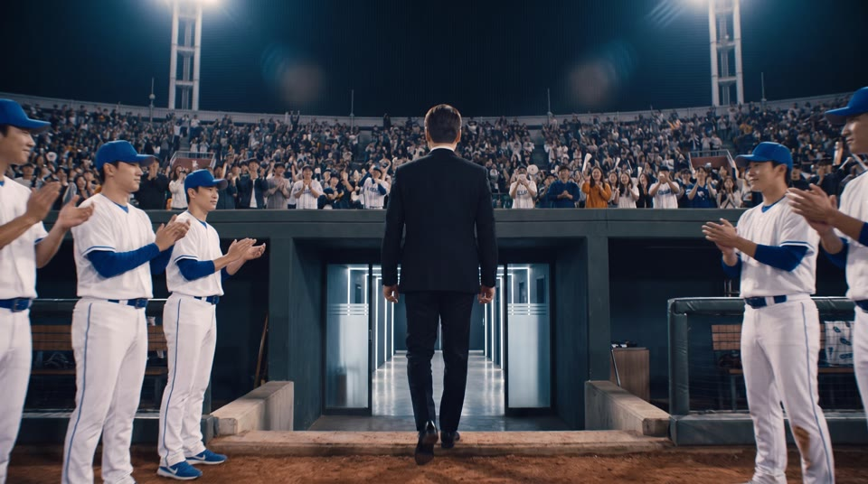 | 더그아웃 계단을 내려가, 더그아웃 안쪽 벽의 복도 입구로 들어가는 뒷모습. 뒤에서 경기장 빛이 역광으로 비추고, 앞쪽 복도에서 흰 LED 빛이 새어 나옴 | 없음 | 함성이 먹먹하게 멀어짐 | 01 c06 어두운 공간으로 긴장 전환 / 03 c02 뒷모습 팔로우 | 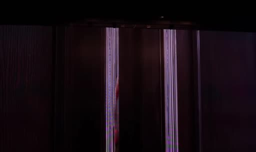  | ✅ AI 이미지 확정(대칭 와이드 — S01과 짝). 복도 인테리어 기준 컷. 선수 운동화의 작은 로고는 그대로 둠. 다음 컷부터 정돈된 컷 전환으로 리듬 바뀜 | `Rear view, camera directly behind him at shoulder height, following him: [GROOM], wearing [OUTFIT], walking down a few concrete steps from the field into the sunken, roofed dugout below field level and heading toward an open doorway in the back wall of the dugout. We see only the back of his head, his shoulders and his back. A few [UNIFORM], standing by the dugout bench on both sides, clapping, in soft focus. [STADIUM]. Behind the camera, the bright floodlit field casts strong backlight and rim light on his shoulders. Through the doorway ahead, cool white light glows from [CORRIDOR]. Handheld 35mm, slight natural shake, slight motion blur. [STYLE]` |
| **S05** | 0:13–0:15 (2초) | 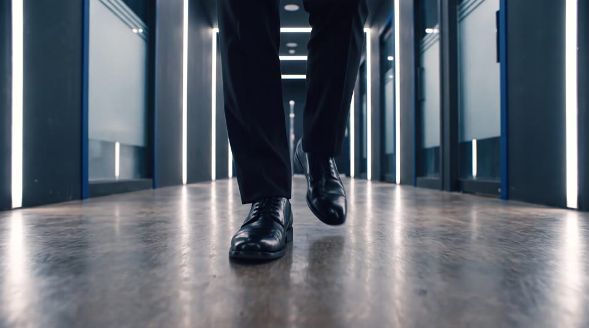 | 걷는 구두 발끝 클로즈업. 바닥 가까이 낮은 앵글로 트래킹 | 없음 | 구두 발소리 또렷하게 | 01 c01 / 02 c06 발 클로즈업 훅 | 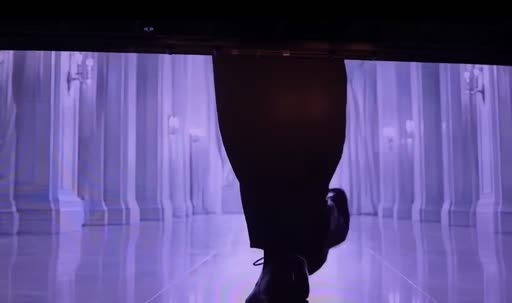 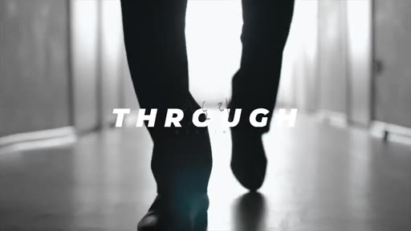 | ✅ AI 이미지 확정. 카메라가 앞에서 뒤로 빠지며 발을 따라가는 구도(방향 전환으로 리듬 변화) | `Floor-level low-angle tracking close-up, camera gliding just above the floor beside his feet: polished black lace-up shoes and the hems of black suit trousers striding forward along [CORRIDOR]. The vertical LED light strips reflect on the polished floor and on the shoes, the corridor behind falls into soft blur. 50mm, shallow depth of field, motion blur on the stepping foot. [STYLE]` |
| **S06** | 0:15–0:18 (3초) | 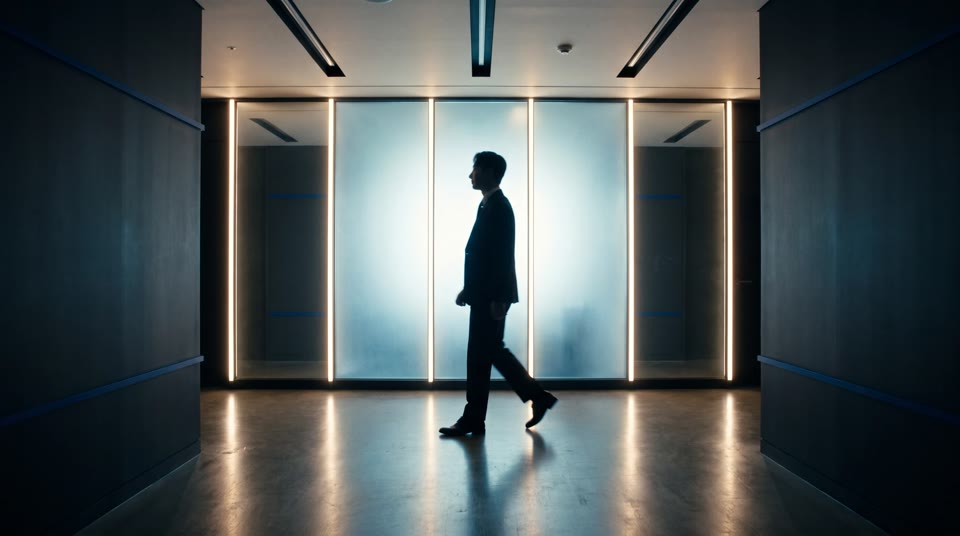 | 복도 측면 풀샷, 밝게 빛나는 벽을 배경으로 한 **검은 실루엣**(얼굴 디테일 없음). 카메라는 고정, 인물이 왼쪽에서 프레임 인 → 오른쪽으로 프레임 아웃. 벽에 구단 엠블럼·트로피 진열장 | 없음 | 빌드업 | 01 c03 공간으로 무게감 주기 (측면 구도로 비틂) |  | ✅ AI 이미지 확정(역광 실루엣). 프레임 아웃 후 빈 복도 0.5초 남기기 | `Static locked-off wide side shot of [CORRIDOR], the far wall behind him glowing bright white from the frosted glass panels and LED strips, so he appears as a pure dark silhouette with no visible facial details: [GROOM], wearing [OUTFIT], walking from frame left to frame right, mid-stride with slight motion blur, only his black outline against the bright wall. Strong backlight, deep shadows on the figure. 32mm. [STYLE]` |
| **S07** | 0:18–0:20 (2초) | 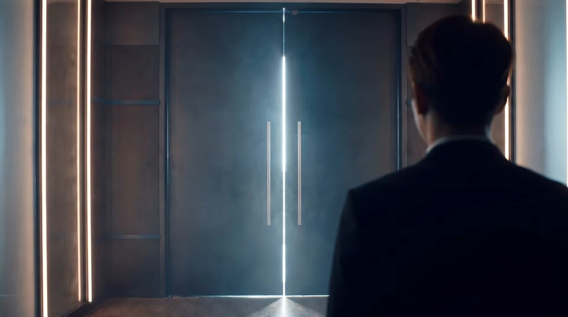 | 어깨 너머 컷: 화면 오른쪽 앞에 신랑의 뒤통수·어깨가 크게, 어둡고 흐리게 걸림. 화면 가운데에는 닫힌 검정 금속 문의 이음새로 흰 빛줄기가 또렷하게 새어 나옴 (문을 마주한 순간) | 없음 | 빌드업 고조 | 01 c06 '곧 이 문이 열린다' / user u02 문틈 빛 |  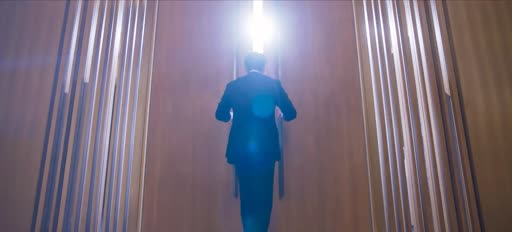 | ✅ AI 이미지 확정. 문을 먼저 보여 주고(S07) → 와이드로 문을 향해 걷는 실루엣(S08) 순서 | `Over-the-shoulder rear view, camera just behind his shoulder: in the foreground at the edge of frame, the out-of-focus back of the head and shoulder of [GROOM], wearing a black suit, dark and backlit with a soft natural rim light. In the center of the frame, in sharp focus, [DOOR], a thin vertical line of brilliant white light glowing through the closed center seam and under the door, soft haze catching the light. The corridor around stays dim. 50mm, shallow depth of field. [STYLE]` |
| **S08** | 0:20–0:22 (2초) | 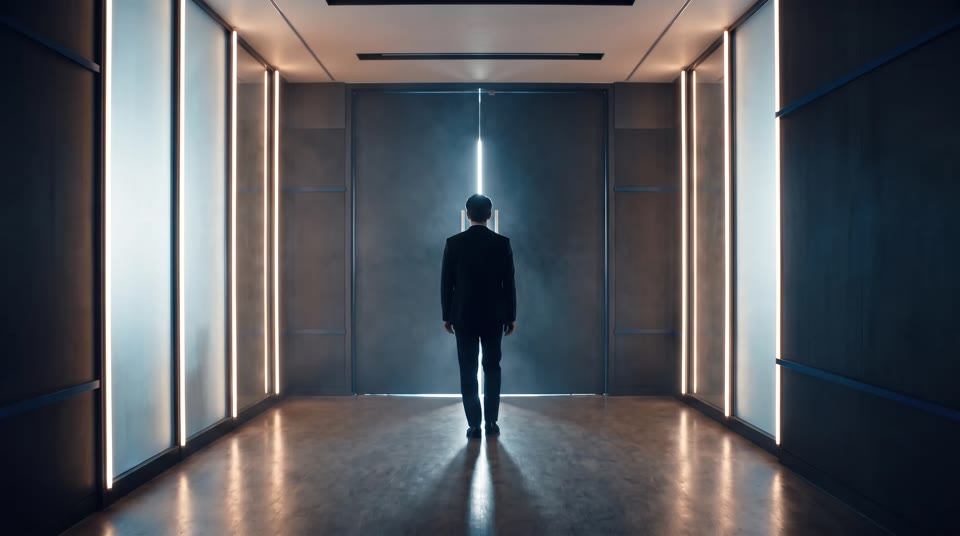 | 복도 정면 대칭 와이드. 화면 정중앙에 작은 **검은 실루엣**으로 걸어가는 신랑, 복도 끝 한가운데 검정 금속 문(문틈·문 아래로 희미한 흰 빛이 역광) | 없음 | 빌드업 | 01 c03 대칭 와이드 + 문 |   | ✅ AI 이미지 확정. **2초(최대 3초) 이내로 짧게** 쓰고 바로 S09로 넘김. 문은 하나(가운데서 갈라짐) — S08 이후 문 디자인 기준 | `Perfectly centered symmetrical one-point-perspective wide rear view, camera on the center line of the corridor behind him. At the far end, centered: [DOOR]. Bright white light leaks through the thin center seam and under the door, spilling across the polished floor toward the camera. [GROOM], wearing [OUTFIT], small in frame, walking away from the camera, his body aligned exactly with the door's center seam so the vertical line of light runs directly behind him, seen as a pure dark silhouette. On both sides, tall walls of bright white LED light act as strong rim backlight, faint haze in the air catching the light, deep contrast, the rest of [CORRIDOR] falling into darkness. 40mm. [STYLE]` |
| **S09** | 0:22–0:23.5 (1.5초) |  | 커프스 단추를 만지는 손 익스트림 클로즈업 | 없음 | 빌드업 고조 | 01 c04 디테일 '준비 완료' | 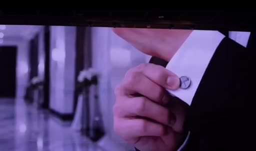 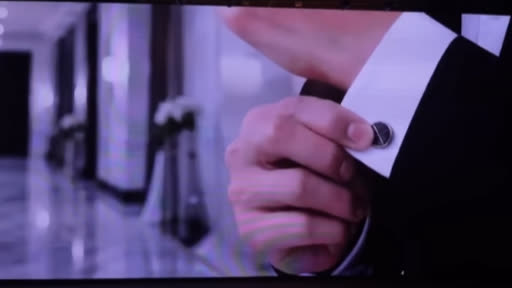 |  | `Extreme macro close-up: the fingers of one hand adjusting a small silver cufflink on a crisp white shirt cuff that peeks out from a black suit sleeve. Dim corridor light, a cool white rim light from the side catching the edge of the cuff and the metal of the cufflink, soft haze, the dark background falling into deep blur. 100mm macro, very shallow depth of field. [STYLE]` |
| **S10** | 0:23.5–0:25 (1.5초) |  | 재킷 단추를 잠그는 손 클로즈업 (가슴~허리, 얼굴 X) | 없음 | 빌드업 고조 | 01 c05 / 02 c05 디테일 | 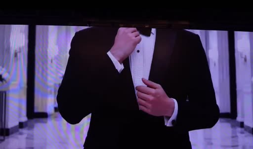 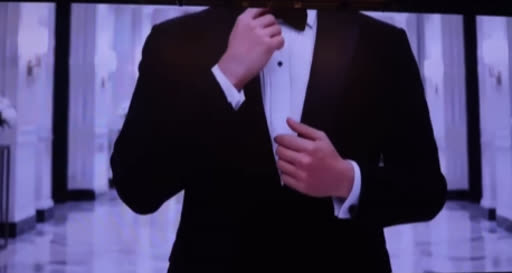 |  | `close-up of hands fastening the button of a black suit jacket over a matching black vest, crisp white dress shirt, black bow tie, a white flower boutonniere on the left lapel at the edge of frame, framed from chest to waist, 85mm, [STYLE]` |
| **S11** | 0:25–0:26.5 (1.5초) |  | 보타이를 바로잡고, 손이 내려와 가슴의 흰 꽃 코사지를 살짝 매만지는 클로즈업 (턱 아래까지만) | 없음 | 빌드업 고조 | 01 c04~c05 디테일 연속 |  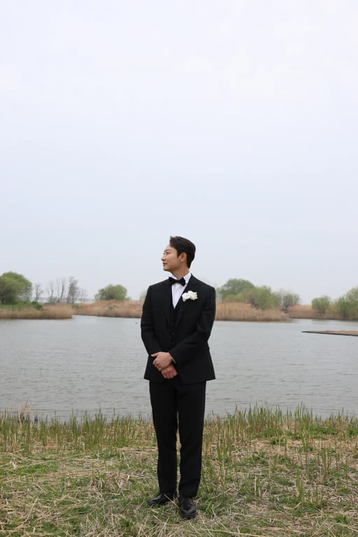 | 본식 의상 확정: 보타이 + 흰 코사지. 코사지가 돋보이는 유일한 컷이라 초점을 코사지에 | `close-up framed from the chin down of fingers straightening a black bow tie, then resting lightly on a white flower boutonniere on the left lapel of a black three-piece suit with a matching black vest and crisp white dress shirt, focus pulled onto the boutonniere, 85mm, [STYLE]` |
| **S12** | 0:26.5–0:28 (1.5초) |  | 양손이 문 손잡이를 동시에 잡는 클로즈업 | 없음 | 빌드업 최고조 | 01 c07 화면 속 문 → 실제 문 복선 | 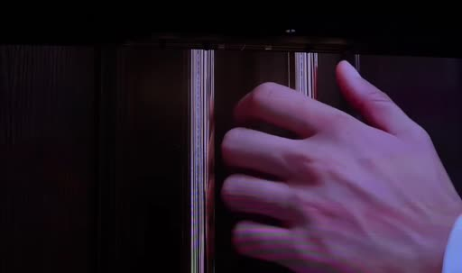 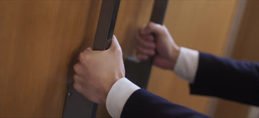 |  | `close-up of both hands gripping the two long vertical brushed-steel bar handles of a single tall, heavy two-leaf matte black metal door that splits exactly in the center, white shirt cuffs and black suit sleeves, tense knuckles, 85mm, [STYLE]` |
| **S13** | 0:28–0:30 (2초) |  | 문이 살짝 열리며 문틈으로 새하얀 빛이 새어 나옴. 로우앵글 뒷모습 실루엣 | 없음 | 문 여는 무거운 소리, 0:29.5 음악 끊김 | user u02 문틈 빛 / 01 c12 문 이음새 = 실제 문 |  | 빛이 갈라지는 자리 = 화면 정중앙 = 실제 문 이음새 | `Low-angle rear view, camera behind him: [GROOM], wearing [OUTFIT], pushing open [DOOR], a narrow vertical blade of brilliant white light bursting through the center gap, light rays through haze, anamorphic lens flare. 24mm. [STYLE]` |
| **S14** | 0:30–0:32 (2초) |  | 양팔로 문을 활짝 밀어 열고 빛 속으로 들어감 → 빛이 화면 전체를 덮으며 화이트 디졸브 | 없음 | 0:30 음악 터짐 | user u03 / 01 c10·03 c15 화이트 플래시 | 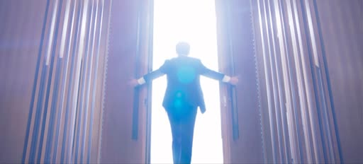 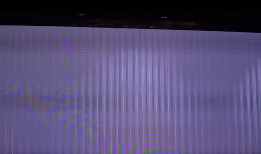 | 이 순간 실제 예식장 문 열림. 문 뒤 하얀 역광 조명 요청 권장 | `Rear view, camera behind him: [GROOM], wearing [OUTFIT], both arms spread wide, pushing both leaves of the single tall, heavy matte black metal door fully open into overwhelming pure white light, his silhouette starting to dissolve into the glow, blooming highlights. 24mm. [STYLE]` |
| **S15** | 0:32–0:33 (1초) |  | 풀 화이트 홀드 | 없음 | 음악 계속 | 03 c15 플래시 후 대기 화면 연결 | 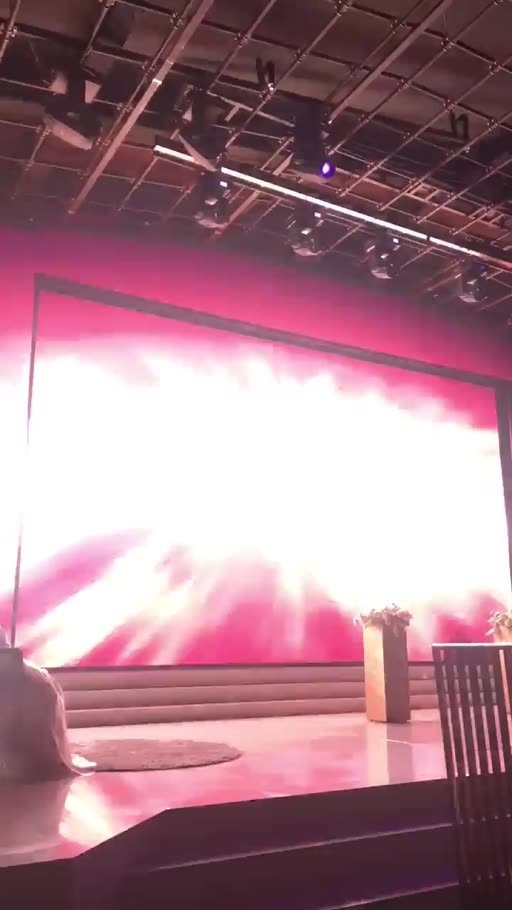 | 실제 문이 열리는 동안 화면은 하얗게 유지 | `(생성 불필요 — 편집에서 순백 화면으로 처리)` |
| **W1** | 0:33–0:36 (3초) |  | 화이트가 걷히며 밤 야구장 상공이 드러남. 첫 불꽃이 양옆에서 터짐 (1회 재생) | 없음 | 음악 계속 + 불꽃 소리 | 02 c11 클라이맥스 뒤 감속 구간 | 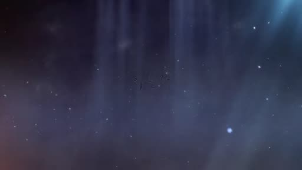 | 정중앙은 비워 둠 | `The pure white light fading away to reveal [STADIUM], seen from high above the infield, the first gold and white fireworks bursting at the far left and far right, center of frame kept empty and dark, no people in close view. 24mm wide. [STYLE]` |
| **W2** | 0:36–0:56 (20초) |  | 대기 화면(20초 루프): 밤 경기장 위로 금색·흰색 불꽃이 좌우에서 천천히 터지고 종이 가루가 내려옴. 좌우 대칭, 정중앙 비움 | 없음 | 음악 계속 | 03 c16 / 02 c12 갈라져도 예쁜 대기 화면 | 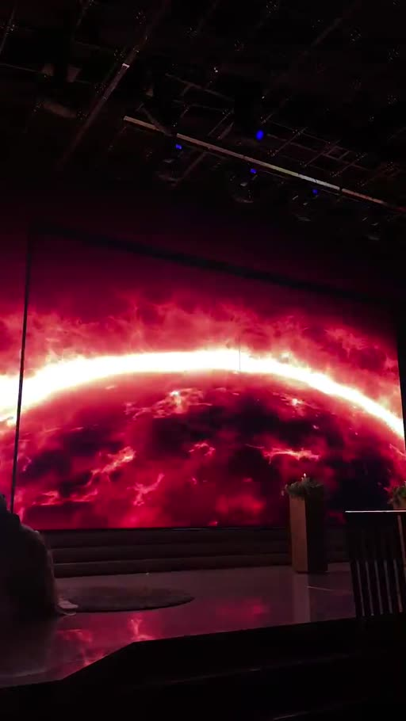 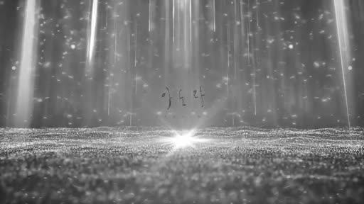 | 처음과 끝 화면이 같게 만들어 이음매 없이 반복. 문이 열린 양쪽에 각각 그림이 보여야 함 | `[STADIUM], seen from high above the field, restrained gold and white fireworks bursting symmetrically on the left and right sides, gold confetti slowly drifting down, center of frame kept empty, calm and elegant. 24mm wide. [STYLE]` |
