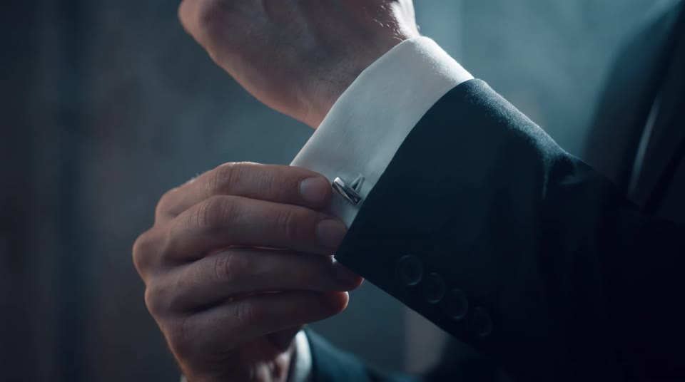
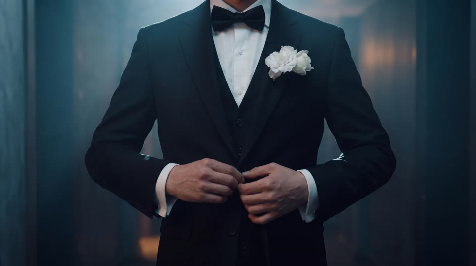
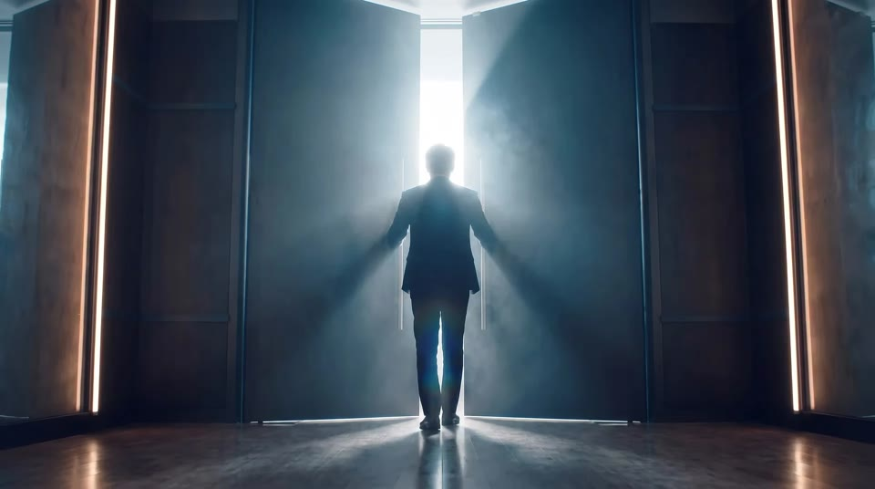
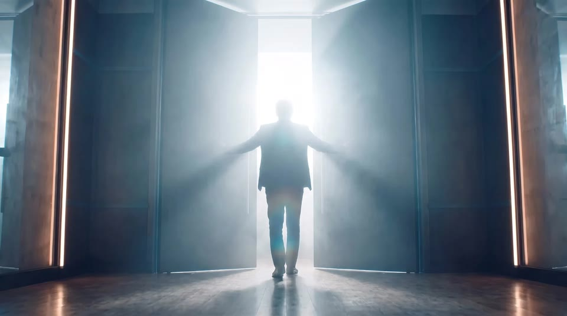
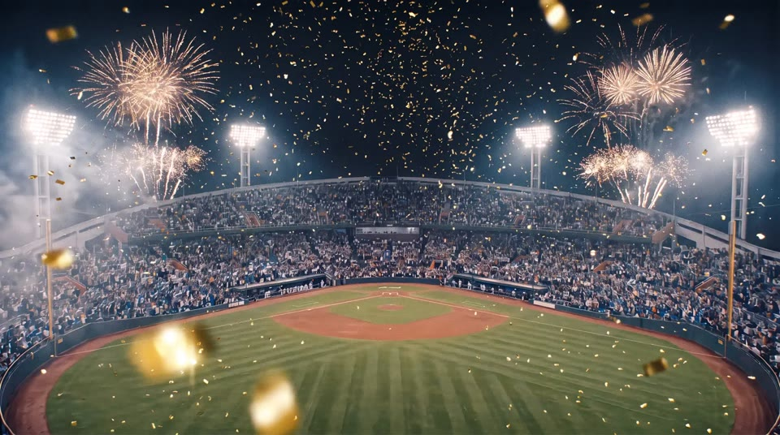

# 스토리보드 — 신랑 입장 영상

- 본편 **0:00~0:33 (33초)**, 문 열림 신호 = S12~S13 (0:28~0:32). 이어서 대기 화면 W1(1회) + **W2 20초 루프**
- 16:9 mp4 / 소스 전부 생성형 AI / 신랑 얼굴 끝까지 숨김
- AI 프롬프트의 `[GROOM]`·`[OUTFIT]`·`[UNIFORM]`·`[STADIUM]`·`[CORRIDOR]`·`[DOOR]`·`[STYLE]`은 `brief.md`의 공통 문구로 바꿔 넣는다 (장소·의상을 바꿀 때는 brief의 해당 문구만 수정)
- **AI 이미지** 열은 확정된 생성 이미지(`ai/씬번호.jpg`). 참고 컷의 `user/`는 사용자가 보낸 참고 이미지, `01·02·03/`은 레퍼런스 캡처

| 씬 | 시간 | AI 이미지 | 화면 설명 | 자막·카피 | 오디오 | 참고 패턴 (영상 번호·컷) | 참고 컷 | 메모 | AI 프롬프트 | 영상 프롬프트(움직임) |
|---|---|---|---|---|---|---|---|---|---|---|
| **S01** | 0:00–0:04 (4초) |  | 마운드에서 출발하는 신랑의 뒷모습 와이드. 낮은 앵글·좌우 대칭(조명탑이 양옆), 관중석 플래시. 카메라는 거의 고정, 아주 느리게 다가감 | 없음 | 음악 도입(잔잔) + 관중 함성 앰비언스 | 03 c02 뒷모습 / 01 c03 대칭 와이드로 공간·무게감 |   | ✅ AI 이미지 확정. 이후 모든 씬의 색감·조명 기준 컷(참고 이미지로 함께 넣기) | `Low-angle symmetrical wide rear view, camera behind him: [GROOM], wearing [OUTFIT], walking away from the camera off the pitcher's mound of [STADIUM]. Two floodlight towers frame the left and right of the frame, crowd camera flashes sparkle in the stands, players lined up at both dugout rails. Camera nearly static with a very slow push-in, 24mm wide lens, floodlight lens flare. [STYLE]` | 카메라가 뒤에서 아주 천천히 다가가고, 신랑은 마운드를 걸어 멀어짐. 관중석 플래시가 반짝이고 조명이 번짐 `The camera slowly pushes in from behind as he walks away across the pitcher's mound. Crowd camera flashes twinkle in the stands, floodlight flares shimmer. He keeps facing away from the camera the whole time; his face never turns toward the camera. Steady cinematic movement.` |
| **S02** | 0:04–0:08 (4초) |  | 컷이 바뀌면 이미 3루 쪽 더그아웃 근처. 파울라인을 따라 비스듬히 걸어가는 뒷모습을 등 뒤 어깨 높이에서 핸드헬드로 따라감. 앞쪽 더그아웃 난간의 선수들이 그를 향해 돌아섬 | 없음 | 관중 함성 + 발소리 | 01 c02 걷기로 존재감 쌓기 / 03 c02 뒷모습 팔로우 |   | ✅ AI 이미지 확정. S01→S02는 **점프컷**(같은 뒷모습·같은 화면 중앙 위치로 이동 거리를 건너뜀). 발걸음이나 음악 박자에 맞춰 자르기 | `Rear view, camera directly behind him at shoulder height: [GROOM], wearing [OUTFIT], walking away from the camera along the third-base foul line toward the dugout a few steps ahead. We see only the back of his head, his shoulders and his back. [STADIUM]. [UNIFORM], lined up at the dugout rail ahead, smiling and starting to clap. Handheld 35mm, slight natural shake, slight motion blur on the legs. [STYLE]` | 등 뒤 어깨 높이에서 핸드헬드로 따라감. 파울라인을 따라 더그아웃 쪽으로 걷고, 난간의 선수들이 박수를 치기 시작 `Handheld camera follows close behind him at shoulder height as he walks along the foul line toward the dugout. The players at the rail start clapping and cheering. He keeps facing away from the camera the whole time; his face never turns toward the camera. Natural handheld sway.` |
| **S03** | 0:08–0:11 (3초) |  | 더그아웃 난간을 따라 걸으며, 고개는 정면을 둔 채 옆 선수와 가볍게 주먹 인사하는 뒷모습. 등 뒤 핸드헬드 팔로잉, 나머지 선수들은 박수 | 없음 | 0:08 음악 빌드업 시작 + 선수들 환호·박수 | 03 c10 '배우' 같은 여유 / 03 c02 뒷모습 팔로우 |   | S02→S03 점프컷(뒷모습 유지). 고개를 돌리면 옆얼굴이 나오니 '정면을 본 채 팔만 옆으로'. ✅ AI 이미지 확정. 음악이 커지는 0:08에 주먹 인사 맞추기 | `Rear view, camera directly behind him at shoulder height, following him: [GROOM], wearing [OUTFIT], walking past the dugout rail toward the dugout entrance. Without turning his head, still looking straight ahead, he casually extends his right fist to the side and lightly bumps fists with a smiling player leaning over the rail on his left. We see only the back of his head, his shoulders and his back. [UNIFORM], other players at the rail clapping in soft focus. [STADIUM]. Handheld 35mm, slight natural shake, slight motion blur on the legs. [STYLE]` | 걸으면서 고개는 정면을 둔 채 손을 뻗어 선수와 가볍게 주먹 인사, 그대로 계속 걸어감 `Handheld follow from behind: while walking, he casually reaches out and lightly bumps fists with the smiling player at the rail, then keeps walking forward. The other players clap. He keeps facing away from the camera the whole time; his face never turns toward the camera.` |
| **S04** | 0:11–0:13 (2초) |  | 더그아웃 계단을 내려가, 더그아웃 안쪽 벽의 복도 입구로 들어가는 뒷모습. 뒤에서 경기장 빛이 역광으로 비추고, 앞쪽 복도에서 흰 LED 빛이 새어 나옴 | 없음 | 함성이 먹먹하게 멀어짐 | 01 c06 어두운 공간으로 긴장 전환 / 03 c02 뒷모습 팔로우 |   | ✅ AI 이미지 확정(대칭 와이드 — S01과 짝). 복도 인테리어 기준 컷. 선수 운동화의 작은 로고는 그대로 둠. 다음 컷부터 정돈된 컷 전환으로 리듬 바뀜 | `Rear view, camera directly behind him at shoulder height, following him: [GROOM], wearing [OUTFIT], walking down a few concrete steps from the field into the sunken, roofed dugout below field level and heading toward an open doorway in the back wall of the dugout. We see only the back of his head, his shoulders and his back. A few [UNIFORM], standing by the dugout bench on both sides, clapping, in soft focus. [STADIUM]. Behind the camera, the bright floodlit field casts strong backlight and rim light on his shoulders. Through the doorway ahead, cool white light glows from [CORRIDOR]. Handheld 35mm, slight natural shake, slight motion blur. [STYLE]` | 뒤에서 따라가며 더그아웃으로 내려서고, 양옆 선수들의 박수 속에 복도 입구로 걸어 들어감 `The camera follows from behind as he steps down into the dugout and walks through the doorway into the bright modern corridor, players clapping on both sides, strong backlight from the field. He keeps facing away from the camera the whole time; his face never turns toward the camera.` |
| **S05** | 0:13–0:15 (2초) |  | 걷는 구두 발끝 클로즈업. 바닥 가까이 낮은 앵글로 트래킹 | 없음 | 구두 발소리 또렷하게 | 01 c01 / 02 c06 발 클로즈업 훅 |   | ✅ AI 이미지 확정. 카메라가 앞에서 뒤로 빠지며 발을 따라가는 구도(방향 전환으로 리듬 변화) | `Floor-level low-angle tracking close-up, camera gliding just above the floor beside his feet: polished black lace-up shoes and the hems of black suit trousers striding forward along [CORRIDOR]. The vertical LED light strips reflect on the polished floor and on the shoes, the corridor behind falls into soft blur. 50mm, shallow depth of field, motion blur on the stepping foot. [STYLE]` | 카메라가 발 앞에서 뒤로 물러나며 걷는 구두를 따라감. 바닥의 LED 반사가 흘러감 `Low tracking shot moving backward just ahead of his feet as he strides forward; the polished shoes step toward the camera, LED reflections slide across the floor. Only the feet and trouser hems are in frame.` |
| **S06** | 0:15–0:18 (3초) |  | 복도 측면 풀샷, 밝게 빛나는 벽을 배경으로 한 **검은 실루엣**(얼굴 디테일 없음). 카메라는 고정, 인물이 왼쪽에서 프레임 인 → 오른쪽으로 프레임 아웃. 벽에 구단 엠블럼·트로피 진열장 | 없음 | 빌드업 | 01 c03 공간으로 무게감 주기 (측면 구도로 비틂) |  | ✅ AI 이미지 확정(역광 실루엣). 프레임 아웃 후 빈 복도 0.5초 남기기 | `Static locked-off wide side shot of [CORRIDOR], the far wall behind him glowing bright white from the frosted glass panels and LED strips, so he appears as a pure dark silhouette with no visible facial details: [GROOM], wearing [OUTFIT], walking from frame left to frame right, mid-stride with slight motion blur, only his black outline against the bright wall. Strong backlight, deep shadows on the figure. 32mm. [STYLE]` | 카메라 고정. 실루엣이 화면 왼쪽에서 오른쪽으로 걸어 나가고, 빈 복도를 0.5초 남김 `Static locked-off camera. His dark silhouette walks from frame left to frame right and exits the frame; hold on the empty glowing corridor for a moment. No facial details visible.` |
| **S07** | 0:18–0:20 (2초) |  | 어깨 너머 컷: 화면 오른쪽 앞에 신랑의 뒤통수·어깨가 크게, 어둡고 흐리게 걸림. 화면 가운데에는 닫힌 검정 금속 문의 이음새로 흰 빛줄기가 또렷하게 새어 나옴 (문을 마주한 순간) | 없음 | 빌드업 고조 | 01 c06 '곧 이 문이 열린다' / user u02 문틈 빛 |   | ✅ AI 이미지 확정. 문을 먼저 보여 주고(S07) → 와이드로 문을 향해 걷는 실루엣(S08) 순서 | `Over-the-shoulder rear view, camera just behind his shoulder: in the foreground at the edge of frame, the out-of-focus back of the head and shoulder of [GROOM], wearing a black suit, dark and backlit with a soft natural rim light. In the center of the frame, in sharp focus, [DOOR], a thin vertical line of brilliant white light glowing through the closed center seam and under the door, soft haze catching the light. The corridor around stays dim. 50mm, shallow depth of field. [STYLE]` | 어깨 너머로 닫힌 문을 향해 아주 천천히 다가감. 문틈의 빛이 은은하게 일렁이고 안개가 흐름 `Very slow push-in over his shoulder toward the closed door. The thin line of light in the door seam flickers softly, haze drifting through it. He stays still, his head stays turned toward the door.` |
| **S08** | 0:20–0:22 (2초) |  | 복도 정면 대칭 와이드. 화면 정중앙에 작은 **검은 실루엣**으로 걸어가는 신랑, 복도 끝 한가운데 검정 금속 문(문틈·문 아래로 희미한 흰 빛이 역광) | 없음 | 빌드업 | 01 c03 대칭 와이드 + 문 |   | ✅ AI 이미지 확정. **2초(최대 3초) 이내로 짧게** 쓰고 바로 S09로 넘김. 문은 하나(가운데서 갈라짐) — S08 이후 문 디자인 기준 | `Perfectly centered symmetrical one-point-perspective wide rear view, camera on the center line of the corridor behind him. At the far end, centered: [DOOR]. Bright white light leaks through the thin center seam and under the door, spilling across the polished floor toward the camera. [GROOM], wearing [OUTFIT], small in frame, walking away from the camera, his body aligned exactly with the door's center seam so the vertical line of light runs directly behind him, seen as a pure dark silhouette. On both sides, tall walls of bright white LED light act as strong rim backlight, faint haze in the air catching the light, deep contrast, the rest of [CORRIDOR] falling into darkness. 40mm. [STYLE]` | 고정된 대칭 와이드. 화면 정중앙의 실루엣이 천천히 문을 향해 걸어감 (짧게 2~3초) `Static symmetrical wide shot. His silhouette walks slowly toward the door in the exact center of the frame, haze drifting in the light from the door seam. No facial details visible.` |
| **S09** | 0:22–0:23.5 (1.5초) |  | 커프스 단추를 만지는 손 익스트림 클로즈업 | 없음 | 빌드업 고조 | 01 c04 디테일 '준비 완료' |   | ✅ AI 이미지 확정 | `Extreme macro close-up: the fingers of one hand adjusting a small silver cufflink on a crisp white shirt cuff that peeks out from a black suit sleeve. Dim corridor light, a cool white rim light from the side catching the edge of the cuff and the metal of the cufflink, soft haze, the dark background falling into deep blur. 100mm macro, very shallow depth of field. [STYLE]` | 손가락이 커프스 단추를 돌려 매만짐. 금속에 빛이 반짝 `Extreme close-up: his fingers turn and adjust the cufflink, a small precise movement, the rim light glinting on the metal. Camera almost still.` |
| **S10** | 0:23.5–0:25 (1.5초) |  | 재킷 단추를 잠그는 손 클로즈업 (가슴~허리, 얼굴 X) | 없음 | 빌드업 고조 | 01 c05 / 02 c05 디테일 |   | ✅ AI 이미지 확정. 편집에서 확대(크롭)해 보타이가 화면 위쪽 끝에 살짝만 걸리게 | `Close-up from the front, framed from just below the chin down to the waist: both hands fastening the single front button of a black suit jacket worn over a matching black vest, crisp white dress shirt, black bow tie at the top edge of the frame, a white flower boutonniere on the left lapel. Dim corridor light, a cool white rim light from the side catching the lapel edges and the fingers, soft haze, dark blurred background. 85mm, shallow depth of field. [STYLE]` | 두 손이 재킷 단추를 잠그고 앞섶을 가볍게 정리. 카메라는 거의 고정, 턱 아래로만 `Close-up framed below the chin: both hands fasten the jacket button and lightly smooth the front of the jacket. Camera almost still, the face never enters the frame.` |
| **S11** | 0:25–0:28 (3초) |  | 살짝 기울어진(더치앵글) 클로즈업: 두 손이 검정 금속 문의 세로 손잡이 두 개를 힘차게 부여잡음. 흰 셔츠 소맷부리와 검은 정장 소매, 힘이 들어간 손마디 | 없음 | 빌드업 최고조 | 01 c07 화면 속 문 → 실제 문 복선 / user u01 더치앵글 손잡이 컷 |   | ⚠️ AI 이미지 임시: 사용자 참고 이미지(나무 문)로 대체. 실제 제작 땐 검정 금속 문·두 손 컷으로 새로 생성(편집에서 10~15도 기울여 더치앵글 가능). 3초 — 잡는 순간 + 힘을 주는 동작 | `Slightly tilted close-up from behind his right side, the door surface filling most of the frame: his arms in black suit sleeves come in from the right edge of the frame, his nearer hand grips a long vertical brushed-steel bar handle low on one leaf of [DOOR], and his other hand grips the second handle a little higher and further back, both fists clenched firmly as if about to pull the door open, crisp white shirt cuffs showing. A thin vertical line of brilliant white light glows through the closed center seam between the two handles, spilling softly onto the knuckles. Dim, moody light, soft haze, a cool white rim light along the edges of the handles and knuckles, slight motion blur. 85mm, shallow depth of field. [STYLE]` | 두 손이 손잡이를 더 꽉 움켜쥐고, 손마디에 힘이 들어가며 문을 열 준비. 문틈 빛이 조금 밝아짐 `Close-up: both hands tighten their grip on the two steel handles, knuckles tensing, a slight push as he prepares to open the door. The light in the door seam grows a little brighter.` |
| **S12** | 0:28–0:30 (2초) |  | 문이 살짝 열리며 문틈으로 새하얀 빛이 새어 나옴. 로우앵글 뒷모습 실루엣 | 없음 | 문 여는 무거운 소리, 0:29.5 음악 끊김 | user u02 문틈 빛 / 01 c12 문 이음새 = 실제 문 |  | ✅ AI 이미지 확정(로우앵글 실루엣). 빛이 갈라지는 자리 = 화면 정중앙 = 실제 문 이음새. 0:29.5 음악 끊김에 맞춰 문틈이 벌어짐 | `Low-angle rear view, camera low behind him: [GROOM], wearing [OUTFIT], pushing both leaves of [DOOR] with both hands, the door just beginning to open. A narrow vertical blade of brilliant white light bursts through the widening center gap, light rays cutting through the haze toward the camera. He is a dark backlit silhouette against the light, only a soft natural rim light on his shoulders and hair, no glow or halo around him. Anamorphic lens flare. 24mm. [STYLE]` | 낮은 앵글. 두 손으로 문을 밀자 문이 열리기 시작하고, 벌어지는 틈으로 흰 빛이 터져 나와 안개를 가름 `Low-angle rear view: he pushes both door leaves and they begin to swing open; a blade of brilliant white light bursts through the widening gap, rays sweeping through the haze. He stays a dark silhouette. He keeps facing away from the camera the whole time; his face never turns toward the camera.` |
| **S13** | 0:30–0:32 (2초) |  | 양팔로 문을 활짝 밀어 열고 빛 속으로 들어감 → 빛이 화면 전체를 덮으며 화이트 디졸브 | 없음 | 0:30 음악 터짐 | user u03 / 01 c10·03 c15 화이트 플래시 |   | ✅ AI 이미지 확정. 0:30 음악 터짐 = 실제 예식장 문 열림. 빛이 화면을 덮으며 S14 하얀 화면으로 디졸브. 문 뒤 하얀 역광 조명 요청 권장 | `Low-angle rear view, camera low behind him, the same moment a second later: [GROOM], wearing [OUTFIT], both arms spread wide, pushing both leaves of [DOOR] fully open. Overwhelming pure white light pours through the open doorway and floods most of the frame, rays cutting through the haze. His dark silhouette in the center is starting to dissolve into the glow, edges softening into the white, blooming highlights. 18mm wide lens, anamorphic lens flare. [STYLE]` | 두 팔을 활짝 벌려 문을 끝까지 열고, 쏟아지는 흰 빛이 화면을 덮으며 실루엣이 하얗게 녹아듦 `He spreads his arms and pushes the doors fully open; overwhelming white light floods in and fills the frame, his silhouette dissolving into pure white by the end of the shot. He keeps facing away from the camera the whole time; his face never turns toward the camera.` |
| **S14** | 0:32–0:33 (1초) |  | 풀 화이트 홀드 | 없음 | 음악 계속 | 03 c15 플래시 후 대기 화면 연결 |  | 실제 문이 열리는 동안 화면은 하얗게 유지 | `(생성 불필요 — 편집에서 순백 화면으로 처리)` | 생성 불필요 — 편집에서 하얀 화면 1초 `(생성 불필요 — 편집에서 순백 화면 처리)` |
| **W1** | 0:33–0:36 (3초) |  | 화이트가 걷히며 밤 야구장 상공이 드러남. 첫 불꽃이 양옆에서 터짐 (1회 재생) | 없음 | 음악 계속 + 불꽃 소리 | 02 c11 클라이맥스 뒤 감속 구간 |  | ✅ AI 이미지 확정(외야 쪽에서 본 대칭 구장). 편집에서 S14 하얀 화면 → 이 이미지로 디졸브. 정중앙 하늘은 비어 있음 | `The pure white light is fading away like mist clearing, revealing [STADIUM] seen from high above and behind home plate, soft white haze still veiling the edges of the frame. The first gold and white fireworks burst at the far left and far right above the stands, the crowd waving blue and white cheering towels. The center of the frame is kept empty and dark. Slow aerial drone view, 24mm wide. [STYLE]` | 하늘에서 아주 천천히 앞으로 흐르는 드론 시점. 좌우에서 첫 불꽃이 터지고 관중이 응원 수건을 흔듦 (편집에서 하얀 화면 → 디졸브) `Very slow aerial drift forward over the stadium. The first fireworks burst at the far left and far right, the crowd waves blue and white towels, smoke drifts. The center of the sky stays empty.` |
| **W2** | 0:36–0:56 (20초) |  | 대기 화면(20초 루프): 밤 경기장 위로 금색·흰색 불꽃이 좌우에서 천천히 터지고 종이 가루가 내려옴. 좌우 대칭, 정중앙 비움 | 없음 | 음악 계속 | 03 c16 / 02 c12 갈라져도 예쁜 대기 화면 |   | ✅ AI 이미지 확정(불꽃·종이 가루 강화, W1과 같은 시점). 처음과 끝 화면이 같게 만들어 이음매 없이 반복. 큰 불꽃은 좌우, 정중앙 하늘은 종이 가루만 | `The same view a few seconds later: [STADIUM] seen from high above the outfield looking toward home plate, perfectly symmetrical. Restrained gold and white fireworks burst symmetrically above the stands on the far left and far right, and gold confetti drifts slowly down through the floodlight beams over the field. The crowd waves blue and white cheering towels. The sky in the center of the frame stays empty and dark. Calm and elegant, made to loop seamlessly. 24mm wide. [STYLE]` | 카메라 완전 고정. 좌우 불꽃이 계속 터지고 종이 가루가 끊임없이 내려옴. 처음과 끝 화면을 같게 해 반복 재생 `Seamless loop with a completely static camera: fireworks keep bursting on the left and right, gold confetti keeps falling, the crowd keeps waving. The first and last frames match so the clip loops without a visible cut.` |
